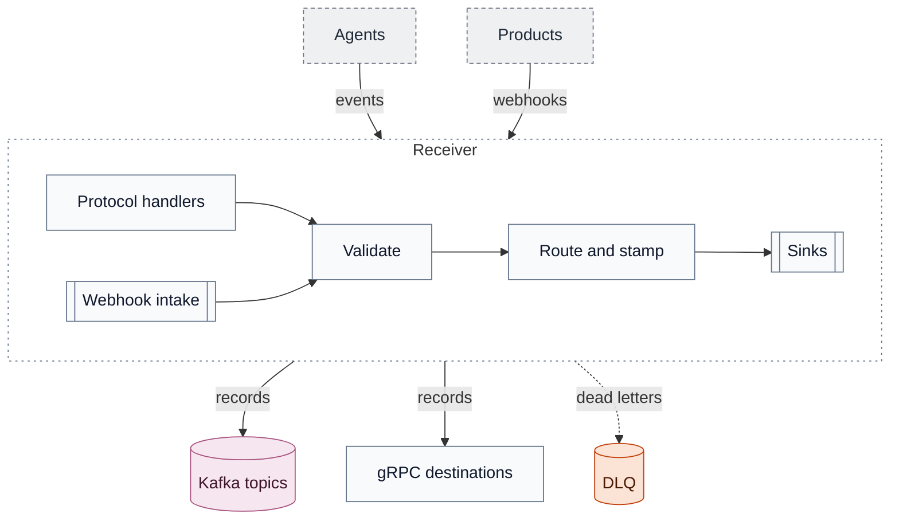

# dfe-receiver architecture

dfe-receiver is DFE's front door for data. Agents and products send to it in whatever protocol they already speak, and it hands JSON on to Kafka or straight to the loader. This page covers why it's built that way and the rules you can't read off the code. Every setting and its default is in [config-schema.yaml](config-schema.yaml), and the component-by-component detail is in [internals.md](internals.md).

## Why it exists

Agents don't speak one protocol. A site running Filebeat, an OpenTelemetry collector, rsyslog, a Splunk forwarder and a Prometheus server has five wire formats on the floor, and nobody wants to change any of them. The pipeline behind wants one thing: JSON, on a Kafka topic or straight to the loader's gRPC listener.

There are three ways to close that gap:

- Put a translator in front of each agent. The number of things to deploy multiplies.
- Teach dfe-loader all five protocols. Network-facing framing and decoding then sit in the middle of the pipeline, next to the enrichment and schema logic.
- Terminate every protocol once, at the edge, and turn it into JSON before anything else sees the data.

dfe-receiver is the third. For every record, it:

- parses the transport framing of each standard machine format (the syslog RFCs, Beats, HEC, OTLP, flow and the rest) into JSON
- stamps `_source`, `_org_id` and `_timestamp_received`
- picks a topic and hands the record on.

It doesn't parse the message body. That's the dfe-transform-* apps' job, and fitting a record to its table is dfe-loader's.

With raw capture on, `_raw` keeps a copy of the original. For syslog and similar protocols it's the only copy: the wire bytes are gone by the time the loader sees the record. `_raw` is taken before redaction, so anything stripped from the parsed fields downstream is still there, indexed for full-text search. That's as much why capture is off by default as the doubled bytes.

## The door outsiders reach

Only a few DFE components take input from outside: the receiver, dfe-ui, dfe-hyperdx (behind the engine's token) and culvert where it's deployed. The loader, archiver and transforms have no listener an outsider can reach, and dfe-fetcher dials out rather than taking calls. So a dependency advisory here isn't the same finding as the same advisory in dfe-loader. Grade reachability first and severity second, as `dfe-infra/docs/threat-model.md` sets out.

The receiver takes traffic from outside the cluster and produces to local Kafka, which never faces the network (`dfe-infra/docs/ingest-edge.md`).

`auth.mode` defaults to `none`. A receiver nobody has configured auth on accepts unauthenticated posts, limited by nothing more than body size, request timeout, the concurrency and connection caps, the IP filter and the rate limiter. So whatever sits in front of it on the internet has to limit who reaches the ports: edge protection, or an allow list on the load balancer.

- In a DFE deployment the public door is `exposure.groups.ingest` (`dfe-infra/docs/ingest-edge.md`). A load balancer renders once its allow list names someone, so an empty list means no public door at all. `publicService` stays off, and is refused if switched on.
- The standalone thin chart defaults to an in-cluster Service alone. Setting `publicService.enabled` adds a load balancer, and an empty `publicService.loadBalancerSourceRanges` leaves it open to every address.

## Components

Every record takes the same path: events from agents and webhooks from products are validated, then routed and stamped, then sent on. Anything refused goes to the DLQ (dead-letter queue).

*Figure 1. L3 Components -- Receiver. Dashed boxes are external, and the dotted arrow is the dead-letter path.* Up: top of dfe-receiver. Down: [L4 Detail -- Webhook intake](webhook-setup.md#how-the-intake-handles-a-request), [L4 Detail -- When a sender is answered](delivery.md#the-answer-waits-for-the-destination).

| Part | Code | What it does |
|---|---|---|
| Protocol handlers | `src/server/<protocol>/` | Each protocol's listeners, framing, decode and auth, handing JSON to the pipeline |
| Webhook intake | `src/server/webhook/` | Per-caller auth, body split and CEL filter, then the caller's topic |
| Validate | `src/validation/` | Nesting depth, JSON object, required fields, read lazily with sonic-rs |
| Route and stamp | `src/routing/` | The rule set, the org clamp, the topic and destinations, and the `_source`, `_org_id` and `_timestamp_received` stamps |
| Sinks | `src/sink/`, `src/buffer/` | The Kafka producer and one gRPC sink per destination, with a buffer in front for answers given at enqueue |
| gRPC destinations | `destinations.*`, `loader.*` | scalo Push listeners: dfe-loader, the transforms, the archiver |
| DLQ | `routing.dlq` | scalo's dead letter queue: by default the `dfe_receiver_dlq` topic, and a local file when Kafka doesn't take the entry |

A protocol handler owns its socket, its framing and its decoding, and nothing else. Once it has JSON bytes it calls the same pipeline every other handler calls. Validation, routing, backpressure and metrics exist once, not once per protocol.

## Listeners and transports

Every protocol is switched on in config, except HTTP, which always runs. It serves `/livez` and `/readyz` beside `/ingest`, so exposing ingest exposes both probes. The chart's probes use the same paths on the metrics port.

`/readyz` answers 503 until every enabled listener is serving, and again once any of them stops. When a listener can't bind, or stops before shutdown, its handler stops all its listeners. The process logs `Protocol handler failed` and stays up, the ingest port's `/readyz` 503 body names each failed handler, and the error stays in the log. An enabled handler that can't be built fails the same way.

`grpc.enabled` defaults to `false`, but a DFE deployment turns it on. dfe-infra's values put the listener on `0.0.0.0:6000`, where it takes Vector's gRPC sink (`PushEvents`). It speaks Vector's protocol, not scalo's Push.

Webhooks get their own routes and per-caller auth instead of a route on `/ingest`, for three reasons:

- `/ingest` checks one server-wide credential before reading the body. A product is identified per caller, and a signed request needs the body to verify it.
- Each product picks its own payload format, so the `rules` rows can't pick its topic.
- With `webhook.bind_address` set, the intake gets its own listener, so a deployment can expose just that port to the product.

Records land on Kafka by default. `transport: grpc` (or `DFE_RECEIVER_TRANSPORT=grpc`), the same key dfe-loader and dfe-archiver read, sends them to the loader's Push listener with no broker in between. Under it an unset `destinations.default` becomes `loader` and an unset `loader.transport` becomes `grpc`, and a config that points either at the bus refuses to start. dfe-infra's slim and mesh profiles set both keys themselves.

## What a sender is told

A listener answers its sender in one of two ways, and which one depends on whether its protocol has an answer to give.

| Listeners | The sender is answered | A record that isn't confirmed |
|---|---|---|
| `server`, `grpc`, `otlp`, `splunk_hec`, `lumberjack`, `fluent`, `webhook`, `prometheus_rw`, with `acknowledgements.enabled` (the default) | Once every destination confirms the request's records, within the hold | Gets the protocol's retry signal, and the sender keeps it and sends it again |
| syslog, GELF and flow, which have no answer to hold, and any listener with acknowledgements off | As soon as the record is queued | Is kept by the receiver, in its buffer and, with spillover on, its spool |

A retry can deliver a record twice, because a destination can take a record and then miss the hold. Duplicates, never loss.

An answer given at enqueue isn't a delivery receipt. The sender has been answered before a broker sees the record, so a kill loses whatever the producer and the buffer held. Turning acknowledgements off, or buffering a held record, gives that guarantee away.

The buffer and spool exist for the second row alone. A held record goes straight to its sink, since the sender still has a copy. [delivery.md](delivery.md) has the hold times, what's final and what's retried, the Kafka producer and the spool.

## Built for throughput, and what that costs

The receiver is designed for petabytes a day, so the core path copies and parses as little as it can.

- A payload stays `bytes::Bytes` from socket to sink. A clone bumps a reference count and copies nothing.
- Routing reads its fields straight out of the payload (`Cow<str>`) instead of building a parsed tree.
- Topic lookups go through `FxHashMap`, and the default source's topic is built once, when the router starts.

The cost is in what validation checks. It checks the payload is JSON, that it's an object, and that the required fields are there, reading lazily with sonic-rs. It doesn't check that the fields hold what downstream expects. A full parse at the door would cost the throughput the receiver is built for.

## Configuration

There are two ways in.

- Without `--config` it's scalo's cascade: compiled defaults, then `defaults.yaml`, `settings.yaml` and `settings.{env}.yaml`, each searched in `./`, `./config/`, `/config/` and `~/.config/dfe-receiver/`, then `./.env`, then `DFE_RECEIVER_*` environment variables, then CLI arguments.
- The container passes `--config /etc/dfe-receiver/config.yaml`, which reads that mounted file over the compiled defaults, then the flat `DFE_RECEIVER_*` variables.

Routing, validation and enrichment reload on SIGHUP and when the config file changes, and so do the gRPC destinations. A reload builds a sender for a destination it adds. It retires one it removes, sending that destination's buffered records to it, or to the DLQ when it can't. With disk spillover on, a destination whose address changed moves to the new one on the same spool once no request is using its old sender, and replays what that sender spooled. The Kafka producer and the DLQ need a restart to change.

Bearer tokens, TLS material and webhook caller secrets can be `provider:path[:key]` references -- `file:`, `vault:`, `aws:`, `env:` -- resolved through `scalo::secrets::resolve`. A reference field rejects a value that names no provider, and a webhook caller's secret is always a reference. Static bearer tokens and accepted header values can instead be literals in the file. The Kafka SASL credential is a plain value, set by `DFE_RECEIVER_KAFKA_SASL_PASSWORD` from the Kafka Secret. The receiver resolves no secret itself. It builds scalo's `secrets-vault` and `secrets-aws` features, so the OpenBao and AWS Secrets Manager providers are in the binary.

