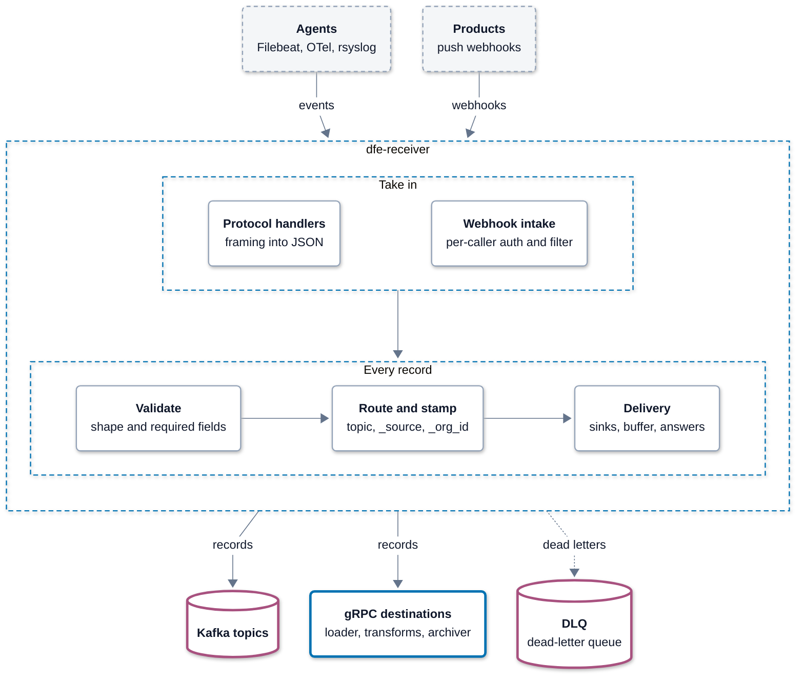

# dfe-receiver architecture

dfe-receiver is DFE's front door for data. Agents and products send to it in whatever protocol they already speak, and it hands JSON on to Kafka or straight to the loader.

*Figure 1. L3 Components -- Receiver. Dashed boxes are outside DFE, and the dotted arrow is the dead-letter path.* Up: [L2 Services -- DFE deployment](https://github.com/hyperi-io/dfe-infra/blob/main/docs/architecture.md). Down: [L4 Detail -- Protocol handlers](protocol-handlers.md), [L4 Detail -- Webhook intake](webhook-setup.md), [L4 Detail -- Delivery](delivery.md).

## How data flows

1. A protocol handler owns its socket, its framing and its decoding, and nothing else. Once it has JSON bytes it calls the same pipeline every other handler calls, so validation, routing, backpressure and metrics exist once, not once per protocol.
2. The webhook intake takes `POST /webhook/{caller}` from a product. It checks that caller's own secret, splits the body into records and runs the caller's [CEL](https://github.com/cel-expr/cel-spec/blob/master/doc/langdef.md) filter.
3. Validate checks each record is a JSON object no deeper than 64 levels, with the fields `validation.required_fields` names. A record missing one goes to the DLQ or is refused, per `validation.dlq_on_invalid`.
4. Route and stamp runs the rule set, holds `_org_id` to the orgs the sender is bound to, and picks the topic and destinations. It writes `_source`, `_org_id` and `_timestamp_received` back into the record.
5. Delivery hands the record to the Kafka producer, or to one gRPC sender per destination, and answers the sender. A record a destination refuses for good goes to the DLQ: by default the `dfe_receiver_dlq` topic, and a local file when Kafka doesn't take the entry.

## Components

| Part | Role | Page |
|---|---|---|
| Protocol handlers | Each protocol's listeners, framing, decode and auth, handing JSON to the pipeline | [protocol-handlers.md](protocol-handlers.md) |
| Webhook intake | Per-caller auth, body split and CEL filter, then the caller's topic | [webhook-setup.md](webhook-setup.md) |
| Validate | Nesting depth, JSON object, required fields, read lazily with sonic-rs | -- |
| Route and stamp | The rule set, the org clamp, the topic and destinations, and the stamps | -- |
| Delivery | The Kafka producer and the gRPC senders, the buffer and spool, and when a sender is answered | [delivery.md](delivery.md) |

Validate and Route and stamp have no page of their own. [internals.md](internals.md) has what the receiver rejects and how a record is routed.

## External dependencies

| Dependency | When it's needed | What can stand in |
|---|---|---|
| Kafka | The default transport, and the default DLQ | Apache Kafka, AutoMQ, AWS MSK and Redpanda on SASL-SCRAM-SHA-512. Confluent Cloud on SASL/PLAIN or OAUTHBEARER |
| gRPC destinations | `transport: grpc`, or a `destinations.*` entry | Any scalo Push listener: dfe-loader, the transforms, the archiver |
| Secrets store | A credential or certificate given as a `provider:path[:key]` reference | `file:`, `vault:` (OpenBao), `aws:` (AWS Secrets Manager), `env:` |
| A volume | `buffer.spillover.enabled` alone | Any writable path |

The receiver resolves no secret itself. scalo does, through `scalo::secrets::resolve`, and the binary builds its OpenBao and AWS Secrets Manager providers.

## Deployment variants

Records land on Kafka by default. `transport: grpc` (or `DFE_RECEIVER_TRANSPORT=grpc`), the same key dfe-loader and dfe-archiver read, sends them to the loader's Push listener with no broker in between. Under it an unset `destinations.default` becomes `loader` and an unset `loader.transport` becomes `grpc`, and a config that points either at the bus refuses to start. dfe-infra's slim and mesh profiles set both keys themselves.

The public door differs by how the receiver is installed.

- In a DFE deployment the public door is `exposure.groups.ingest` (`dfe-infra/docs/ingest-edge.md`). A load balancer renders once its allow list names someone, so an empty list means no public door at all. `publicService` stays off, and is refused if switched on.
- The standalone thin chart defaults to an in-cluster Service alone. Setting `publicService.enabled` adds a load balancer, and an empty `publicService.loadBalancerSourceRanges` leaves it open to every address.

The released chart scales on CPU alone: 80% use, 1 to 10 replicas. In a DFE deployment, dfe-infra's values set the CPU target to 70% and add the ScalingPressure trigger, and the slim profile clears that trigger again. The receiver never scales on raw Kafka consumer lag.

## Design considerations

**Security.** Only a few DFE components take input from outside: the receiver, dfe-ui, dfe-hyperdx (behind the engine's token) and culvert where it's deployed. So a dependency advisory here isn't the same finding as the same advisory in dfe-loader. Grade reachability first and severity second, as `dfe-infra/docs/threat-model.md` sets out.

`auth.mode` defaults to `none`. A receiver nobody has configured auth on accepts unauthenticated posts, limited by nothing more than body size, request timeout, the concurrency and connection caps, the IP filter and the rate limiter. So whatever sits in front of it on the internet has to limit who reaches the ports. [hardening.md](hardening.md) has the fronting options.

**Reliability.** What a sender is told depends on whether its protocol has an answer to give.

| Listeners | The sender is answered | A record that isn't confirmed |
|---|---|---|
| `server`, `grpc`, `otlp`, `splunk_hec`, `lumberjack`, `fluent`, `webhook`, `prometheus_rw`, with `acknowledgements.enabled` (the default) | Once every destination confirms the request's records, within the hold | Gets the protocol's retry signal, and the sender keeps it and sends it again |
| syslog, GELF and flow, which have no answer to hold, and any listener with acknowledgements off | As soon as the record is queued | Is kept by the receiver, in its buffer and, with spillover on, its spool |

A retry can deliver a record twice, because a destination can take a record and then miss the hold. Duplicates, never loss. An answer given at enqueue isn't a delivery receipt: a kill loses whatever the producer and the buffer held.

**Operations.** Routing, validation, enrichment and the gRPC destinations reload on SIGHUP and when the config file changes. The Kafka producer and the DLQ need a restart to change. A bearer token rotates without a restart, refreshed from its secret source. [internals.md](internals.md#configuration) has the config cascade and what a reload does to each destination.

**Performance.** The receiver is designed for petabytes a day, so the core path copies and parses as little as it can. A payload stays `bytes::Bytes` from socket to sink, and routing reads its fields straight out of the payload instead of building a parsed tree. [performance.md](performance.md) has the tuning.

## Why it's built this way

**One front door for every protocol.** A site running Filebeat, an OpenTelemetry collector, rsyslog, a Splunk forwarder and a Prometheus server has five wire formats on the floor, and nobody wants to change any of them. A translator in front of each agent multiplies what there is to deploy. Teaching dfe-loader all five puts network-facing decoding in the middle of the pipeline, next to the enrichment and schema logic. So every protocol is terminated once, at the edge, and turned into JSON before anything else sees the data.

**It stops at the transport framing.** Parsing the message body is the dfe-transform-* apps' job, and fitting a record to its table is dfe-loader's.

**Validation checks the shape, not the values.** It checks the payload is JSON, that it's an object, and that the required fields are there. It doesn't check the fields hold what downstream expects. A full parse at the door would cost the throughput the receiver is built for.

**Webhooks get their own routes.** `/ingest` checks one server-wide credential before reading the body, but a product is identified per caller, and a signed request needs the body to verify it. Each product picks its own payload format, so the `rules` rows can't pick its topic. And with `webhook.bind_address` set, a deployment can expose just that port to the product.

**Raw capture is off by default.** With it on, `_raw` keeps a copy of the original. For syslog and similar protocols it's the only copy: the wire bytes are gone by the time the loader sees the record. `_raw` is taken before redaction, so anything stripped from the parsed fields downstream is still there, indexed for full-text search. That's as much why capture is off as the doubled bytes.

## Diagram map

- Figure 1. L3 Components -- Receiver (this page)
  - [L4 Detail -- Protocol handlers](protocol-handlers.md)
  - [L4 Detail -- Webhook intake](webhook-setup.md)
  - [L4 Detail -- Delivery](delivery.md)
  - [L4 Detail -- HTTP request order](hardening.md), and the fronting diagrams on the same page
  - [L4 Detail -- Sidecar transports](sidecar-transports.md)

## What's next

- [config-schema.yaml](config-schema.yaml): every setting and its default
- [internals.md](internals.md): what the receiver rejects, routing, auth and Kafka in detail
- [metrics.md](metrics.md): every series and alert
- [hardening.md](hardening.md): fronting the receiver on the internet
- [CONTRIBUTING.md](../CONTRIBUTING.md#context): where the code lives and what tends to bite
