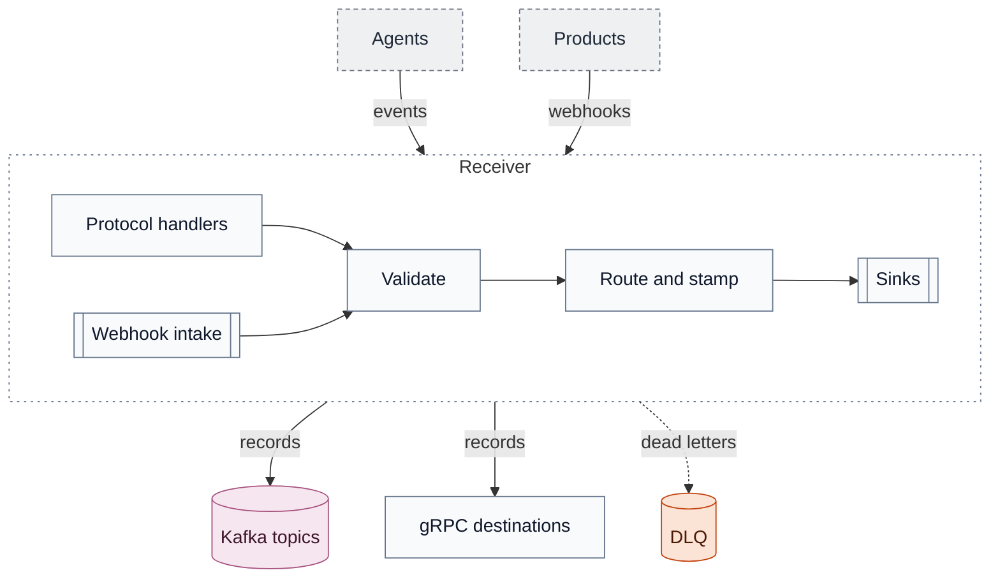

# dfe-receiver architecture

Why the service is built the way it is, and the rules you cannot read off the
code. Every setting and its default is in [config-schema.yaml](config-schema.yaml),
and the component-by-component detail is in [internals.md](internals.md).

## The problem

Agents do not speak one protocol. A site already running Filebeat, an
OpenTelemetry collector, rsyslog, a Splunk forwarder and a Prometheus server has
five wire formats on the floor and no appetite for changing any of them. The DFE
pipeline behind wants one thing: JSON, on a Kafka topic or straight to the loader's
gRPC listener.

Three ways to close that gap. Put a translator in front of each agent, and the
deployment count multiplies. Teach dfe-loader the five protocols, and
network-facing framing and decode move into the middle of the pipeline, next to
the enrichment and schema logic. Or terminate every protocol once, at the edge,
and normalise before anything else sees the data.

dfe-receiver is the third option. Everything below follows from it.

## What that makes it

The one external door for data. dfe-receiver, dfe-ui, dfe-hyperdx (user facing,
behind the engine's token) and, where it is deployed, culvert are the components
that take untrusted input -- the loader, archiver and transforms have no
listener an outsider reaches, and dfe-fetcher dials out rather than being
dialled. So a dependency advisory here is not the same finding as the identical
advisory in dfe-loader. Grade reachability first, severity second, per
`dfe-infra/docs/threat-model.md`. The ingest edge is
`dfe-infra/docs/ingest-edge.md`: the receiver takes traffic from outside the
cluster and produces to local Kafka, which never faces the network.

It is not a transform stage. The receiver parses the transport framing of each
standard machine format (the syslog RFCs, Beats, HEC, OTLP, flow and the rest)
into JSON, stamps `_source`, `_org_id` and `_timestamp_received`, picks a topic
and hands over. Parsing a message body is the dfe-transform-* apps' job, and
fitting a record to its table is dfe-loader's. `_raw` is the one copy of the
original it can keep, where raw capture is on: for syslog and friends the wire
bytes are gone by the time the loader sees the record.

## Components

This diagram shows the parts inside the receiver and what each side of it talks to.

*Figure 1. L3 Components -- Receiver. Dashed boxes are external, and the dotted arrow is the dead-letter path.* Up: top of dfe-receiver. Down: [L4 Detail -- Webhook intake](webhook-setup.md#how-the-intake-handles-a-request), [L4 Detail -- When a sender is answered](delivery.md#the-answer-waits-for-the-destination).

| Part | Code | What it does |
|---|---|---|
| Protocol handlers | `src/server/<protocol>/` | Each protocol's listeners, framing, decode and auth, handing JSON to the pipeline |
| Webhook intake | `src/server/webhook/` | Per-caller auth, body split and CEL filter, then the caller's own topic |
| Validate | `src/validation/` | Nesting depth, JSON object, required fields, read lazily with sonic-rs |
| Route and stamp | `src/routing/` | The rule set, the org clamp, the topic and destinations, and the `_source`, `_org_id` and `_timestamp_received` stamps |
| Sinks | `src/sink/`, `src/buffer/` | The Kafka producer and one gRPC sink per destination, with a buffer in front for answers given at enqueue |
| gRPC destinations | `destinations.*`, `loader.*` | scalo Push listeners: dfe-loader, the transforms, the archiver |
| DLQ | `routing.dlq` | scalo's dead letter queue: by default the `dfe_receiver_dlq` topic, and a local file when Kafka does not take the entry |

Many handlers, one core path. A handler owns its socket, its framing and its
decode, and nothing else. The moment it holds JSON bytes it calls the same
pipeline every other handler calls, so validation, routing, backpressure and
metrics exist once rather than once per handler.

`ProtocolHandler` (`src/server/traits.rs`) is where the two halves meet: `name()`, `bind_address()`, `listeners()`, `start(shutdown)`. `Server::build_handlers` (`src/server/mod.rs`) collects the enabled handlers, and `Server::run` spawns each one. Adding a protocol is a directory under `src/server/`, a config section, a block in `build_handlers` and a port in the deployment contract (`src/deployment.rs`). It does not touch the core path.

`listeners()` returns one `BoundAddr` per socket the handler binds, and `/readyz` waits on all of them: it answers 503 until every enabled listener is serving, and again once any of them stops. A listener that cannot bind, or stops before shutdown, fails its handler's `start()`, the handler's other listeners stop with it, and the process logs `Protocol handler failed` and stays up. The ingest port's `/readyz` 503 body names each failed handler, and the error stays in the log. An enabled handler that cannot be built fails the same way.

## Listeners and transports

HTTP is the exception to opt-in: it always runs. It serves `/livez` and `/readyz`
beside `/ingest`, so exposing ingest exposes both probe paths. The chart's probes
use the same paths on the metrics port.

`grpc.enabled` defaults to `false`, but a DFE deployment turns it on: dfe-infra's
values set the listener on `0.0.0.0:6000`, where it takes Vector's gRPC sink
(`PushEvents`). It speaks Vector's protocol, not scalo's Push.

Records land on Kafka by default. `transport: grpc` (or `DFE_RECEIVER_TRANSPORT=grpc`), the same key dfe-loader and dfe-archiver read, sends them to the loader's Push listener with no broker in the path. Under it an unset `destinations.default` becomes `loader` and an unset `loader.transport` becomes `grpc`, and a config that sets either to the bus fails to start. dfe-infra's slim and mesh profiles set those two keys themselves.

The webhook intake has its own routes and per-caller auth rather than a route on
`/ingest`, for reasons worth keeping. `/ingest` checks one server-wide credential in middleware
before the body is read, where a product is identified per caller and a signed
request needs the body to verify. A product's payload format is its own, so
the `rules` rows cannot pick its topic. And with `webhook.bind_address` set it takes a
listener of its own, so a deployment can expose only that port to the product's egress.

## The hot path, and what it costs

A design target of petabytes a day sets the rules for the core path. The payload
stays `bytes::Bytes` from socket to sink -- reference-counted, so a clone copies
nothing. Field extraction for routing borrows out of the payload (`Cow<str>`)
rather than building a DOM. Topic lookups use `FxHashMap`, and the default
source's topic is formatted once, when the router is built.

The consequence a reader should know: validation proves the payload IS JSON and
that any required fields are present. It does not prove the payload
carries what downstream expects. That is deliberate -- a full parse at the door would
cost the throughput the design exists for.

## Delivery: the answer waits for the destination

A listener whose protocol carries an answer holds it until every destination confirmed the request's records (`acknowledgements.enabled`, default on). A record not confirmed within the hold gets the protocol's retryable refusal, and the sender keeps it: duplicates, never loss. A buffer, and its spool, exist only for answers given at enqueue, from syslog, GELF, flow and any listener with acknowledgements off. The hold, what is final, the producer and the spool are in [delivery.md](delivery.md).

## Configuration

Two paths in. Without `--config` it is scalo's cascade: compiled defaults, then `defaults.yaml`, `settings.yaml` and `settings.{env}.yaml`, each searched in `./`, `./config/`, `/config/` and `~/.config/dfe-receiver/`, then `./.env`, then `DFE_RECEIVER_*` environment variables, then CLI arguments. The container passes `--config /etc/dfe-receiver/config.yaml`, which reads that mounted file over the compiled defaults, then the flat `DFE_RECEIVER_*` variables. Routing, validation and enrichment reload on SIGHUP and when the config file changes, and so do the gRPC destinations: a reload builds the sender of a destination it adds and retires one it removes, whose buffered records go to it or else the DLQ. With disk spillover on, a destination whose address changes moves to the new address on the same spool once no request uses its old sender, and replays what that sender spooled. The Kafka producer and the DLQ change only with a restart.

Bearer tokens, TLS material and webhook caller secrets can be `provider:path[:key]` references -- `file:`, `vault:`, `aws:`, `env:` -- resolved through `scalo::secrets::resolve`, and a reference field refuses a value that names no provider. A webhook caller's secret is always one. Static bearer tokens and accepted header values can also sit in the file as literals. The Kafka SASL credential is a plain value, set by `DFE_RECEIVER_KAFKA_SASL_PASSWORD` from the Kafka Secret. The receiver has no resolver of its own, and builds scalo's `secrets-vault` and `secrets-aws` features so the OpenBao and AWS Secrets Manager providers are in the binary.

## Invariants

In rough order of the damage getting them wrong does.

1. An answer given at enqueue is not a delivery receipt. With
   `acknowledgements.enabled: false` the client has been answered by the time a
   broker sees the record, and a kill loses what the producer and the buffer
   held. The default holds the answer until the destination confirmed it, and a
   change that answers earlier, or buffers a held record, gives that away.

2. The `Dockerfile` is generated, not written. It comes from the deployment contract in `src/deployment.rs`, and a unit test fails when the committed file no longer matches. Regenerate with `dfe-receiver --emit-dockerfile Dockerfile`. A scalo bump can change the generator, so a bump without a regenerate fails this repo's own suite by design.

3. No chart is committed. At release, hyperi-ci emits the contract with `generate-artefacts` and assembles a thin chart from it on the scalo-service library chart at `release.helm.library`, which moves with the scalo version in `Cargo.toml`. A deployment wires the receiver's listeners by port name, so a renamed port breaks it. The contract marks every ingest port public and the gRPC port internal. `hyperi-ci chart assemble --binary target/debug/dfe-receiver --image <image>@sha256:<digest>` builds the chart a release would ship and prints its directory.

4. `auth.mode` defaults to `none`. A deployment that has not configured auth accepts unauthenticated posts, limited only by body size, request timeout, the concurrency and connection caps, the IP filter and the rate limiter. Whatever faces the internet in front of it has to limit who reaches the ports: edge protection, or an allow list on the load balancer.

   In a DFE deployment the public door is `exposure.groups.ingest` (`dfe-infra/docs/ingest-edge.md`). Load balancers render only while its allow list names someone, so an empty list is no public door at all, and `publicService` stays off and is refused if switched on. The standalone thin chart's default is an in-cluster Service only: there a load balancer exists once a deployment sets `publicService.enabled`, and an empty `publicService.loadBalancerSourceRanges` leaves it open to every address.

5. `_raw` holds the payload before redaction. Anything stripped from the
   parsed fields downstream is still in `_raw`, indexed for full-text search.
   Capture is off by default for that reason as much as for the doubled bytes.

6. `Config::validate()` runs in `load_config` (`src/main.rs`) on every start, `--config` path included. A test that builds a
   `Config` struct directly never reaches it, which is how the brokerless test
   configurations work. Do not read a passing test as proof that a YAML file
   would be accepted.
