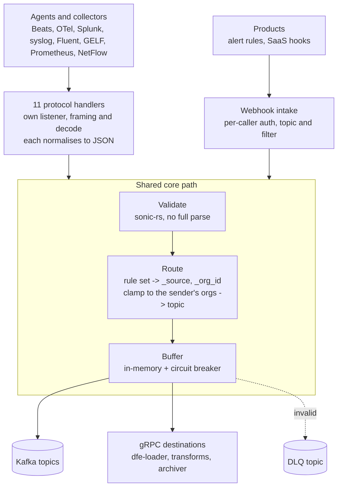

# dfe-receiver architecture

Why the service is shaped the way it is, and the rules you cannot read off the
code. The configuration reference is [config.example.yaml](../config.example.yaml);
the component-by-component detail is in [internals.md](internals.md).

## The problem

Agents do not speak one protocol. A site already running Filebeat, an
OpenTelemetry collector, rsyslog, a Splunk forwarder and a Prometheus server has
five wire formats on the floor and no appetite for changing any of them. The DFE
pipeline behind wants one thing: JSON on a Kafka topic.

Three ways to close that gap. Put a translator in front of each agent, and the
deployment count multiplies. Teach dfe-loader the five protocols, and
network-facing framing and decode move into the middle of the pipeline, next to
the enrichment and schema logic. Or terminate every protocol once, at the edge,
and normalise before anything else sees the data.

dfe-receiver is the third option. Everything below follows from it.

## What that makes it

The one external door. dfe-receiver and dfe-ui are the only two components in
the stack that read untrusted input -- the loader, archiver and transforms have
no listener an outsider reaches, and dfe-fetcher dials out rather than being
dialled. So a dependency advisory here is not the same finding as the identical
advisory in dfe-loader. Grade reachability first, severity second, per
`dfe-infra/docs/threat-model.md`. The ingest edge is
`dfe-infra/docs/ingest-edge.md`, which calls the receiver a
single-homed airlock: traffic from outside, produce to local Kafka, and Kafka
never faces the network.

It is not a transform stage. The receiver decides a payload is JSON, stamps
`_source`, `_org_id` and `_timestamp_received`, picks a topic and hands over. Parsing,
enrichment and schema work are dfe-loader's. The one deliberate exception is
`_raw`: the receiver can retain the original wire bytes because for syslog and
friends that fidelity is gone by the time the loader sees the record.

## Shape

Eleven handlers, one core path. A handler owns its socket, its framing and its
decode, and nothing else. The moment it holds JSON bytes it calls the same
pipeline every other handler calls, so validation, routing, backpressure and
metrics exist once rather than eleven times.

`ProtocolHandler` (`src/server/traits.rs`) is where the two halves meet: `name()`, `bind_address()`, `listeners()`, `start(shutdown)`. `Server::build_handlers` (`src/server/mod.rs:125`) collects the enabled handlers, and `Server::run` spawns each one. Adding a protocol is a directory under `src/server/` plus a block in `build_handlers` -- it does not touch the core path.

`listeners()` returns one `BoundAddr` per socket the handler binds, and `/readyz` waits on all of them: it answers 503 until every enabled listener is serving, and again once any of them stops. A listener that cannot bind, or stops before shutdown, fails its handler's `start()`, the handler's other listeners stop with it, and the process logs `Protocol handler failed` and stays up. The ingest port's `/readyz` 503 body names each failed handler, and the error stays in the log. An enabled handler that cannot be built fails the same way.

HTTP is the exception to opt-in. It always runs, because `/livez` and `/readyz`
ride its listener, so exposing ingest exposes both probe paths.

The webhook intake is its own handler rather than a route on `/ingest`, for
reasons worth keeping. `/ingest` checks one server-wide credential in middleware
before the body is read, where a product is identified per caller and a signed
request needs the body to verify. A product's payload shape is its own, so
the `rules` rows cannot pick its topic. And an own listener lets a
deployment expose only that port to the product's egress.

## The hot path, and what it costs

PB/s-a-day throughput sets the rules for the core path. The payload stays
`bytes::Bytes` from socket to sink -- reference-counted, so a clone copies
nothing. Field extraction for routing borrows out of the payload (`Cow<str>`)
rather than building a DOM. Topic lookups use `FxHashMap`. No `format!()` on the
path.

The consequence a reader should know: validation proves the payload IS JSON and
that any required fields are present. It does not prove the payload is
well-shaped for downstream. That is deliberate -- a full parse at the door would
cost the throughput the design exists for.

## Delivery: the answer waits for the destination

A listener whose protocol carries an answer holds it until every destination confirmed the request's records: a Kafka delivery report, a gRPC destination's answer, or a dead-letter write the DLQ confirmed. That is `acknowledgements.enabled`, default on, per listener: `server`, `grpc`, `otlp`, `splunk_hec`, `lumberjack`, `fluent`, `webhook`, `prometheus_rw`. Syslog, GELF and flow have no answer to hold.

A record not confirmed within the hold gets the protocol's retryable refusal (503 with `Retry-After`, `UNAVAILABLE`, no ack), and the sender keeps it. That means "not confirmed", not "not written": a Kafka message timeout can expire while a produce request is in flight, so a resend can deliver a record twice. Duplicates, never loss.

A delivery report that refuses the record itself for good -- the same codes that take a spooled record off the spool, below -- is answered exactly as librdkafka refusing it at enqueue is: accepted once the DLQ holds it, refused for good (400 on HTTP) where no DLQ can, and retryable where the DLQ refuses the write. Neither path is retried forever.

The hold is 25 s, short of the listener's request timeout or a gRPC sender's `grpc-timeout` by a margin. OTLP HTTP exports carry no deadline, so they hold 9 s (`otlp.http_max_hold_ms`), inside the OTel exporters' 10 s default timeout. The producer held answers use runs `message.timeout.ms` 20 s unless the operator set one, and a gRPC destination's send deadline is 20 s (`loader.timeout_ms` for the loader), so both settle inside the hold. A send still running when a shorter hold ends is cut off and answered retryable.

Records answered at enqueue have no resend behind them, so beside a held listener they get a producer of their own on librdkafka's default timeout, and the sink queues again every one librdkafka gives up on with a message timeout (`receiver_kafka_resends_total`), new records waiting in the buffer in front meanwhile. Any other broker refusal is final, and what is still queued at exit is lost. Admission, the held-byte ceiling (a quarter of the memory limit per listener) and the `transport_ack_*` metrics are scalo's `Tickets`, behind the pipeline's own pressure brake and memory lease.

With `acknowledgements.enabled: false` a listener answers once the record is queued. `receiver_kafka_sends_total` is what librdkafka queued, `receiver_kafka_delivered_total` what a broker acknowledged, and `receiver_kafka_delivery_failures_total{reason}` what no broker confirmed. `pipeline_delivery_guarantee{listener,guarantee,reason}` reports what each listener gives: its weakest reachable leg, so a gRPC destination declared `confirms_delivery: false` (the archiver's direct listener answers on receipt) makes every held listener `best_effort`.

The sink builds its own `ThreadedProducer` instead of using scalo's
`KafkaProducer`, because scalo hard-codes a `ProducerContext` with no injection
point and a delivery report needs one. The cost is `producer_client_config()`
(`src/sink/kafka/mod.rs:141`), a hand copy of scalo's config assembly and its
precedence -- profile defaults, then `librdkafka_overrides`, then the sizing
surface, which wins. It goes wrong quietly if scalo reorders or adds a key.
scalo-rs#26 is the long-term fix.

No listener answers success for a record the pipeline did not take: a sender that reads a false success discards the record, and nothing downstream can recover it. A failure is final only when the record itself is at fault -- malformed, over a destination's size ceiling, or sent without valid credentials. Anything else tells the sender to retry, in its own protocol's terms, and a batch stops at the first record not taken. The sender resends the whole request, so the records taken before it arrive twice: duplicates, never loss. Each listener's answer, and the protocol rule behind it, is in [internals.md](internals.md#what-a-sender-is-told).

## Buffering: only for answers given at enqueue

A held answer sends straight to the destination's sink: the sender still has the record, so nothing buffers or spools it. A buffer, and its spool, are built only when some enabled listener answers at enqueue -- one with `acknowledgements.enabled: false`, or syslog, GELF or flow. With every listener holding, `buffer.spillover.enabled` opens no spool.

For answers given at enqueue, the default backend is an in-memory buffer behind a circuit breaker, with no disk involved. For the Kubernetes deployment that is the right trade -- OOMKill plus KEDA answers a backlog by adding pods, and a spool on an ephemeral volume buys little. The buffer counts as healthy only while its sink is healthy and it has room, so a broker refusing every record stops admission rather than letting the queue hide it.

Disk spillover exists for deployments that want crash-resilient buffering or run outside Kubernetes. `buffer.spillover.enabled` swaps the backend for scalo's `TieredSink` with a disk spool, one directory per sink under `buffer.spillover.path`: `kafka/` for the bus and `grpc/<name>/` for each gRPC destination. Two sinks cannot share a spool. `SinkBackend` (`src/buffer/mod.rs`) is the enum holding one or the other. Either way the shutdown drains into the sink and then flushes it.

A spooled record leaves the spool only once its destination confirms it: for the bus, its Kafka delivery report, and for a gRPC destination, the RPC's answer. A crash before then replays it from disk on the next start rather than losing it. A record taken on the hot path is answered once librdkafka queues it, as its sender is. The drain waits for one confirmation per record, because scalo's drain offers the spool one record at a time. A confirmation that does not come within the spool's `send_timeout_ms` leaves the record spooled and offers it again, so a slow broker can be sent a spooled record more than once: duplicates, never loss. A delivery report that refuses the record itself for good (invalid record or timestamp, topic or cluster authorisation failed, unknown or invalid topic) takes it off the spool through the DLQ like any other refused record, and any other failed report keeps it spooled. A broker's size refusal is not one of them: it fails the whole batch librdkafka sent, records that fit included, so each is offered again. librdkafka refuses a record over its own `message.max.bytes` at enqueue, so a broker limit below the producer's shows as delivery failures until the two agree.

A buffered record a destination refuses for good leaves once the DLQ confirms the write. While the DLQ refuses, it stays at the front and holds up the records behind it: its sender was answered at enqueue, so dropping it would be loss.

## Configuration

A cascade, scalo's: compiled defaults, then `/etc/dfe-receiver/config.yaml`, then `./config.yaml`, then `~/.config/dfe-receiver/config.yaml`, then `DFE_RECEIVER_*` environment variables, then CLI arguments, then runtime overrides. Routing, validation and enrichment reload on SIGHUP, and so do the gRPC destinations: a reload builds the sender of a destination it adds and retires one it removes, whose buffered records go to it or else the DLQ. With disk spillover on, a destination whose address changes moves to the new address on the same spool once no request uses its old sender, and replays what that sender spooled. The Kafka producer and the DLQ change only with a restart.

Secrets are never literals in the config file. Every credential is a `provider:path[:key]` reference -- `file:`, `vault:`, `aws:`, `env:` -- resolved through `scalo::secrets::resolve`. The receiver has no resolver of its own, and builds scalo's `secrets-vault` and `secrets-aws` features so the OpenBao and AWS Secrets Manager providers are in the binary.

## Invariants

The rules a reader cannot infer, in rough order of how much damage getting them
wrong does.

1. **An answer given at enqueue is not a delivery receipt.** With
   `acknowledgements.enabled: false` the client has been answered by the time a
   broker sees the record, and a kill loses what the producer and the buffer
   held. The default holds the answer until the destination confirmed it; a
   change that answers earlier, or buffers a held record, gives that away.

2. **The `Dockerfile` is generated, not written.** It comes from the deployment contract in `src/deployment.rs`, and a unit test fails when the committed file no longer matches. Regenerate with `dfe-receiver --emit-dockerfile Dockerfile`. A scalo bump can change the generator, so a bump without a regenerate fails this repo's own suite by design.

3. **No chart is committed.** At release, hyperi-ci emits the contract with `generate-artefacts` and assembles a thin chart from it on the scalo-service library chart at `release.helm.library`, which moves with the scalo version in `Cargo.toml`. A deployment wires the receiver's listeners by port name, so a renamed port breaks it.

4. **dfe-engine hand-mirrors `Config::validate()`.** The copy lives at
   `dfe-engine/src/dfe_engine/services/plugins_builtin/receiver.py` and no script
   compares the two. They have already drifted both ways: the engine refuses a
   config where gRPC and HTTP share a `bind_address`, which this repo does not
   check anywhere, and this repo has since grown destination, webhook,
   rate-limit and spillover rules the engine copy has never heard of. A
   validation change here is only half the change.

5. **`auth.mode` defaults to `none`.** A deployment that has not configured auth accepts unauthenticated posts, limited only by body size, request timeout, the IP filter and the rate limiter. The chart's default is an in-cluster Service only: a load balancer exists once a deployment sets `publicService.enabled`, and an empty `publicService.loadBalancerSourceRanges` leaves it open to every address. The receiver is built to sit behind edge protection, never directly on the internet.

6. **`_raw` holds the payload before redaction.** Anything stripped from the
   parsed fields downstream is still in `_raw`, indexed for full-text search.
   Capture is off by default for that reason as much as for the doubled bytes.

7. **`Config::validate()` only runs on the cascade path.** A test that builds a
   `Config` struct directly never reaches it, which is how the brokerless test
   configurations work. Do not read a passing test as proof that a YAML file
   would be accepted.
