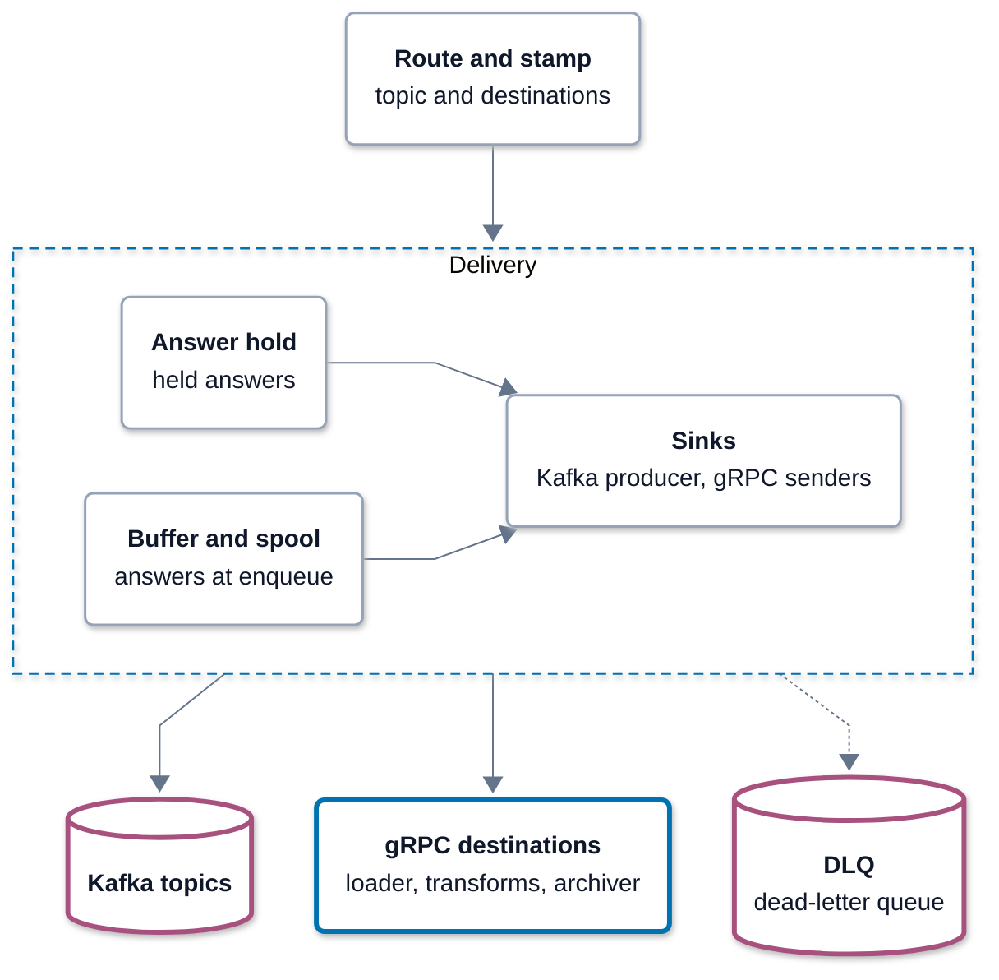
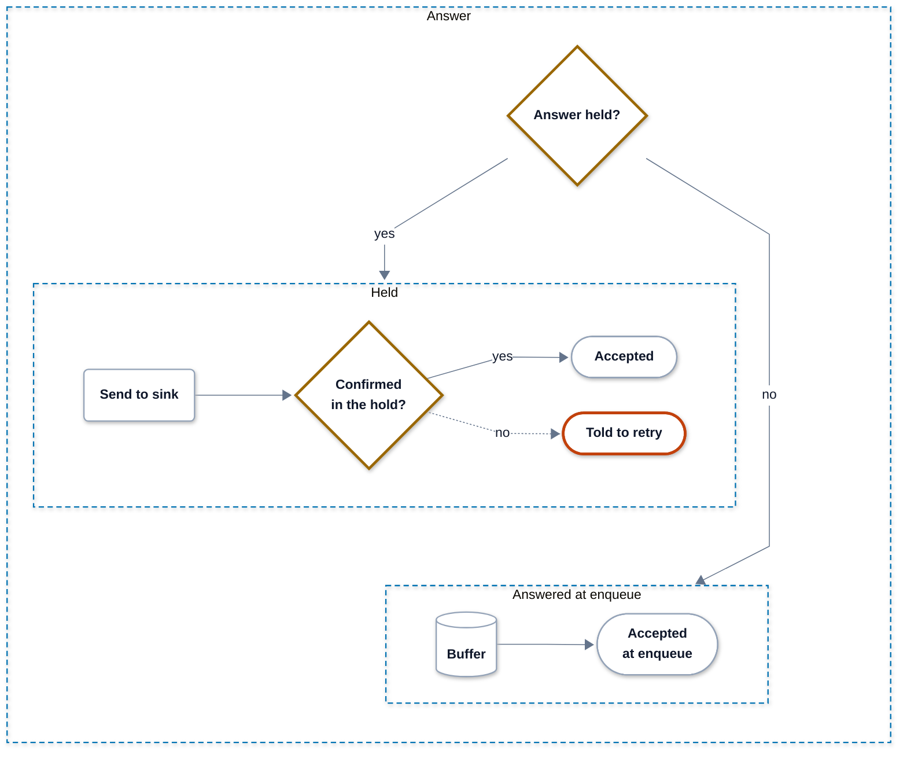

# Delivery

Delivery is the last stage of [dfe-receiver](architecture.md): it sends each record to Kafka or a gRPC destination, and decides when the sender is answered.

| | |
|---|---|
| Repo | [hyperi-io/dfe-receiver](https://github.com/hyperi-io/dfe-receiver) |
| Image and chart | `ghcr.io/hyperi-io/dfe-receiver`, and the thin chart released beside it |
| Config reference | `acknowledgements` on each listener, `kafka`, `destinations`, `loader`, `buffer` and `routing.dlq` in [config-schema.yaml](config-schema.yaml) |
| Endpoints | None of its own. It answers through the listener that took the record |
| Metrics | `receiver_kafka_*`, `receiver_destination_*`, `transport_ack_*`, `pipeline_delivery_guarantee`, in [metrics.md](metrics.md#kafka) |

Which path a record takes is set by the listener that took it, not by the record.

*Figure 1. L4 Detail -- Delivery. The dotted arrow is the dead-letter path.* Up: [L3 Components -- Receiver](architecture.md). Down: [L4 Detail -- When a sender is answered](#the-answer-waits-for-the-destination).

Each listener's answer, and the protocol rule behind it, is in [internals.md](internals.md#what-a-sender-is-told).

## The answer waits for the destination

A listener with an answer in its protocol holds it until every destination confirmed the request's records: a Kafka delivery report, a gRPC destination's answer, or a dead-letter write the DLQ confirmed. That is `acknowledgements.enabled`, default on, per listener: `server`, `grpc`, `otlp`, `splunk_hec`, `lumberjack`, `fluent`, `webhook`, `prometheus_rw`. Syslog, GELF and flow have no answer to hold.

A held answer waits for the destination and bypasses the buffer, and an enqueue answer is given at once.

*Figure 2. L4 Detail -- When a sender is answered. The dotted arrow is the retry path.* Up: [L4 Detail -- Delivery](delivery.md).

A buffered record drains to the same sink later, and the sender has no copy of it by then. A record refused for good is answered as the next section says, whichever way it went.

A record not confirmed within the hold gets the protocol's retryable refusal (503 with `Retry-After`, `UNAVAILABLE`, no ack), and the sender keeps it. That means "not confirmed", not "not written": a Kafka message timeout can expire with a produce request in flight, so a resend can deliver a record twice. Duplicates, never loss.

The hold sits short of the listener's request timeout or a gRPC sender's `grpc-timeout` by a margin. OTLP HTTP exports have no deadline, so their hold stays inside the OTel exporters' default timeout. The held producer's message timeout and a gRPC destination's send deadline both settle inside the hold. A send still running when a shorter hold ends is cut off and answered retryable.

| Bound | Default | Source |
|---|---|---|
| The hold | 25 s | `MAX_HOLD`, `src/pipeline/acks.rs` |
| The hold for OTLP HTTP exports | 9 s, under the OTel exporters' 10 s | `otlp.http_max_hold_ms` |
| `message.timeout.ms` of the producer for held answers, unless the operator set one | 20 s | `HELD_MESSAGE_TIMEOUT`, `src/pipeline/acks.rs` |
| A gRPC destination's send deadline | 20 s | `NEXT_HOP_DEADLINE_MS`, and `loader.timeout_ms` for the loader |

A listener holds at most a quarter of the memory limit in unanswered bytes, 256 MiB when the guard reports no limit, and answers a request past it with the retry signal. Admission, that ceiling and the `transport_ack_*` metrics are scalo's `Tickets`, behind the pipeline's pressure brake and memory lease. The lease answers the retry signal to a request the brake let through whose bytes would take the memory guard's usage reading past the memory limit.

## What is final, and what is retried

No listener answers success for a record the pipeline did not take: a sender that reads a false success discards the record, and nothing downstream can recover it. A failure is final only when the record itself is at fault -- malformed, over a destination's size ceiling, or sent without valid credentials. Anything else tells the sender to retry, in its protocol's terms, and a batch stops at the first record not taken. The sender resends the whole request, so the records taken before it arrive twice: duplicates, never loss.

A delivery report that rejects the record itself for good -- the same codes that take a spooled record off the spool, below -- is answered exactly as librdkafka refusing it at enqueue is: accepted once the DLQ holds it, refused for good (400 on HTTP) where no DLQ can, and retryable where the DLQ rejects the write. Neither path is retried forever.

## Answers given at enqueue

With `acknowledgements.enabled: false` a listener answers once the record is queued. `receiver_kafka_sends_total` is what librdkafka queued, `receiver_kafka_delivered_total` what a broker acknowledged, and `receiver_kafka_delivery_failures_total{reason}` what no broker confirmed. `pipeline_delivery_guarantee{listener,guarantee,reason}` reports what each listener gives: its weakest reachable leg, so a gRPC destination declared `confirms_delivery: false` (the archiver's direct listener answers on receipt) makes every held listener `best_effort`.

Records answered at enqueue have no resend behind them, so beside a held listener they get a separate producer on librdkafka's default timeout. The sink queues again every one librdkafka gives up on with a message timeout, a topic the cluster does not serve or an authorisation failure (`receiver_kafka_resends_total`), and later records wait in the buffer in front. Any other broker refusal is final, and what is still queued at exit is lost.

The sink builds a `ThreadedProducer` instead of using scalo's `KafkaProducer`, because scalo hard-codes a `ProducerContext` with no injection point and a delivery report needs one. Its librdkafka config still comes from scalo's `producer_client_config`, over the `PRODUCER_HIGH_THROUGHPUT` profile, so the precedence is scalo's -- profile defaults, then the sizing surface, then `librdkafka_overrides`, which wins.

## Buffering is for answers given at enqueue

A held answer sends straight to the destination's sink: the sender still has the record, so nothing buffers or spools it. A buffer, and its spool, are built when some enabled listener answers at enqueue -- one with `acknowledgements.enabled: false`, or syslog, GELF or flow. With every listener holding, `buffer.spillover.enabled` opens no spool.

For answers given at enqueue, the default backend is an in-memory buffer behind a circuit breaker, with no disk involved. For the Kubernetes deployment that is the right trade -- OOMKill plus KEDA answers a backlog by adding pods, and a spool on an ephemeral volume buys little. Admission does not wait on a destination: the buffer queues while its sink is down and answers the retry signal once it is full, and a held record bound for a down destination is refused at once, unsent. Records bound for other destinations are taken meanwhile.

Disk spillover exists for deployments that want crash-resilient buffering or run outside Kubernetes. `buffer.spillover.enabled` swaps the backend for scalo's `TieredSink` with a disk spool, one directory per sink under `buffer.spillover.path`: `kafka/` for the bus and `grpc/<name>/` for each gRPC destination. Two sinks cannot share a spool. A spool that won't open at startup (its directory can't be created, or scalo refuses it) doesn't stop the receiver: that sink gets the in-memory buffer instead, logged at ERROR and shown as `receiver_spool_available` at `0`, until a restart opens the spool. `SinkBackend` (`src/buffer/mod.rs`) is the enum holding one or the other. Either way the shutdown drains into the sink and then flushes it.

## The spool keeps a record until it is confirmed

A spooled record stays on the spool until its destination confirms it: for the bus, its Kafka delivery report, and for a gRPC destination, the RPC's answer. A crash before then replays it from disk on the next start rather than losing it. A record taken on the hot path is answered once librdkafka queues it, as its sender is. The drain waits for one confirmation per record, because scalo's drain offers the spool one record at a time. A confirmation that does not come within the spool's `send_timeout_ms` leaves the record spooled and offers it again, so a slow broker can be sent a spooled record more than once: duplicates, never loss.

A delivery report that rejects the record itself for good (invalid record or timestamp, invalid topic, unknown partition) takes it off the spool through the DLQ like any other refused record, and any other failed report keeps it spooled. A topic or cluster authorisation failure is the receiver's ACL, not the record, so it keeps the record as well. A topic the cluster does not serve is not refused for good either, because a just-created or unpropagated topic reads the same as one that never exists. Its records stay spooled, and a record answered at enqueue is queued again, until the topic is served. A topic that never exists shows as a sampled ERROR log, `receiver_kafka_delivery_failures_total{reason="UnknownTopicOrPartition"}` and the sink reading unhealthy, with no give-up.

A broker's size refusal is not one of them: it fails the whole batch librdkafka sent, records that fit included, so each is offered again. librdkafka rejects a record over its `message.max.bytes` at enqueue, so a broker limit below the producer's shows as delivery failures until the two agree. A buffered record a destination rejects for good leaves once the DLQ confirms the write. Until the DLQ takes it, it stays at the front and holds up the records behind it: its sender was answered at enqueue, so dropping it would be loss.
