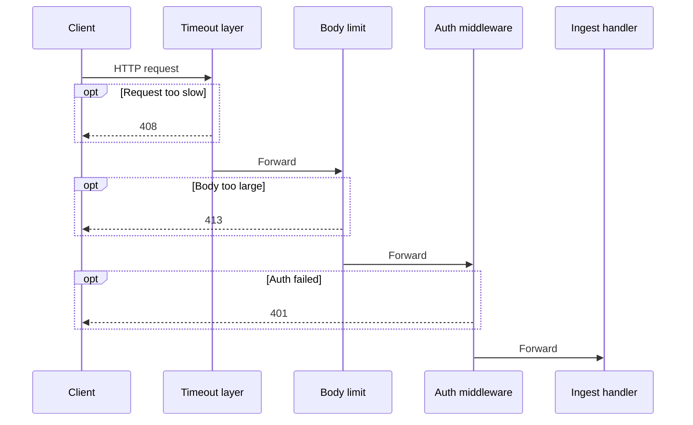
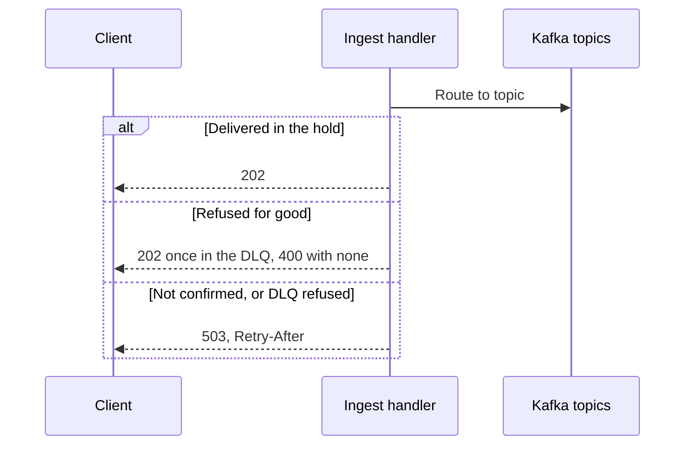
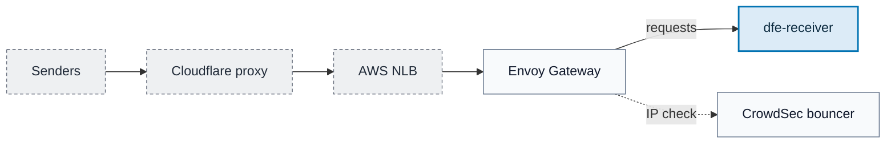

# Internet-Facing Hardening & Fronting Architecture

**dfe-receiver is the internet-facing ingest component in the DFE stack. dfe-ui, dfe-hyperdx and, where it is deployed, culvert take untrusted input as well (`dfe-infra/docs/threat-model.md`).**

Application-level hardening, and cost-conscious fronting on Kubernetes and AWS.

---

## What the Receiver Enforces

| Protection | Status | Config |
|---|---|---|
| Request body size limit (413) | 10 MiB (HTTP, OTLP HTTP, HEC, RW), 1 MiB (webhook). The body extractors read to the same limit | `server.max_body_size` (HTTP, OTLP HTTP), `splunk_hec.max_body_size`, `prometheus_rw.max_body_size`, `webhook.max_body_size` |
| Request timeout (408) | 30s, every HTTP listener | `server.request_timeout_ms` (HTTP, OTLP HTTP), `splunk_hec.request_timeout_ms`, `prometheus_rw.request_timeout_ms`, `webhook.request_timeout_ms` |
| Slowloris protection | 5s header_read_timeout, every HTTP listener (hyper) | `HEADER_READ_TIMEOUT` |
| Connections closed for a limit | Counted by transport and reason (`over_limit`, `no_first_byte`, `frame_timeout`, `idle`) | `receiver_connections_closed_total` |
| First byte timeout | 30s, every TCP listener the receiver accepts on: a connection that sends nothing by then is closed | `server.connections.first_byte_timeout_ms` |
| Frame timeout | 30s, every raw TCP listener (syslog TCP and TLS, Lumberjack, Fluent Forward, GELF): once a frame's first byte arrives, a frame not whole by then closes its connection and frees its place under the cap. An oversize syslog or GELF frame being skipped is still a frame in progress. Time between whole frames and time a frame waits on the pipeline are not counted. A 32 MiB Lumberjack or Fluent frame needs about 1 MiB/s to arrive in time | `server.connections.frame_timeout_ms` |
| Connection idle timeout | 300s with no request in flight, every HTTP listener, HTTP/1 keep-alive and HTTP/2 alike (an idle HTTP/1 connection can close sooner, on the header read timeout). A peer that does not finish the graceful close is dropped. Lumberjack, Fluent Forward and GELF keep an idle connection, under the cap, since closing one under a sender loses its next line | `server.connections.idle_timeout_ms` |
| Syslog TCP idle timeout and keepalive | Syslog TCP and TLS close a connection with no frame for 600s, a frame part way in being the frame timeout's. Keepalive probes start after 60s quiet and repeat every 60s, so a peer that has gone frees its place | `syslog.idle_timeout_ms` (0 = keep), `syslog.tcp_keepalive_secs` (0 = off) |
| HTTP/2 keep-alive | Ping every 60s, close after 20s unanswered, every HTTP listener and both gRPC listeners | `server.connections.http2_keep_alive_interval_ms` |
| Connection cap | 10,000 open connections per listener, every TCP listener and both gRPC listeners. One past it is closed as it is accepted | `server.connections.max_per_listener` (0 = no cap) |
| Concurrency limit | 10,000 in-flight requests default, per HTTP listener | `server.max_concurrent_requests` |
| Per-IP rate limiting | GCRA via tower-governor, opt-in, per HTTP listener, keyed on the TCP peer (forwarding headers from `server.trusted_proxies` alone). Clients with a refilled budget are dropped from its key map every 5s | `server.rate_limit.*`, `server.trusted_proxies` |
| Flow per-source rate limiting | Token bucket per UDP source, opt-in. The bucket map never holds more than `cache_size` (default 4096) sources: a further source past it evicts an idle bucket where one is among the first 32 looked at, else the first, counted on `flow_rate_limit_evicted_total`, so spoofed sources cannot grow it | `flow.rate_limit.*` |
| IP filter (allowlist/denylist) | CIDR trie, connection-level reject, in every accept loop the receiver runs. The gRPC and OTLP gRPC ports have none: tonic runs their accept loops. An unknown mode, a bad CIDR or an empty allowlist stops startup | `server.ip_filter.*` |
| 503 backpressure | HTTP + gRPC ingest shed load when pipeline not ready | `Retry-After: 5` |
| TLS termination | Per-protocol. The ingest, webhook, HEC, remote write and OTLP HTTP listeners reload certificate material given as a secret reference every `refresh_interval_secs`. A certificate file, every other listener and every other `tls.*` setting load once at start, so a change to them is a restart | `*.tls.enabled`, `*.tls.cert_secret` |
| TLS handshake timeout | 10s, every TLS listener the receiver accepts on | `server.connections.tls_handshake_timeout_ms` |
| mTLS client auth | Per-protocol | `*.tls.client_auth: required` |
| Bearer token auth | Per-protocol, hot-reloadable | `*.auth.mode: bearer` |
| Header auth | HTTP ingest, HEC and remote write, against `accepted_headers` (or the legacy `header_name`). An unknown `*.auth.mode` stops startup | `server.auth.mode: header` |
| Credential-less listeners | Refuse to start without client certificates required or the opt-out | `*.accept_unauthenticated` |
| JSON validation | Global, always on: a body that is not JSON is refused with a 400 | Not configurable |
| Required field check | Global | `validation.required_fields` |
| Dead-letter queue | Global | `routing.dlq` |
| Memory pressure backpressure | 503 / `UNAVAILABLE` on HTTP and gRPC ingest | `DFE_RECEIVER_MEMORY_PRESSURE_THRESHOLD`, `self_regulation.*` (`buffer.*` bounds the destination queues and nothing else) |
| Middleware ordering | RateLimit -> Concurrency -> Timeout -> BodyLimit -> Auth -> Handler, behind the accept loop's IP filter | Cheapest refusal first |
| Frame size validation | GELF 1MB, Syslog 64KB, Fluent 32MB. An oversize syslog or GELF message is skipped to its delimiter and counted (`receiver_records_dropped_total`, reason `oversize`), and its connection goes on. Fluent Forward has no delimiter to resume at, so an oversize frame closes its connection | Per-protocol limits, `syslog.max_message_size`, `gelf.max_message_size` |
| Decoded-size budget | An OTLP export, remote-write request or Vector push past 100,000 records, 1,000,000 messages or 64 MiB of resource, scope, metric or series-label bytes copied into its records, or holding a protobuf group, is refused before it decodes: 400 on HTTP, `INVALID_ARGUMENT` on gRPC. A Fluent Forward message past 1,000,000 values, 100,000 entries or 64 MiB of tag copies closes its connection, found by a scan that reads each byte once. A Splunk HEC request past 100,000 events or raw lines, or 64 MiB of `host`, `source`, `sourcetype` and `index` copied into its raw lines, is refused with a 400 | Hard-coded |
| Zip-bomb rejection | Lumberjack nested compression rejected. A compressed frame is decompressed one inner frame at a time and refused past 64 MiB | Hard-coded |
| Unsettled bytes per connection | Lumberjack settles and ACKs a window in parts past 16 MiB of events | Hard-coded |
| Health/readiness (K8s) | `/livez`, `/readyz`: 503 until every enabled listener serves, once one stops (drain included), and under memory pressure | Metrics port and the HTTP ingest port |
| Graceful shutdown | CancellationToken + in-flight drain | All handlers |
| Log spam prevention | Sampled (1/100) + debounced (5s) logging. A refused credential logs once per 5s per reason, an IP-filter refusal once per 5s per listener, and a counter has every one | Per-protocol |
| `#![forbid(unsafe_code)]` | Entire crate | Cargo.toml lints |

---

## Application-Level Hardening

Each HTTP request meets the cheapest refusal first, so a bot scan or an unauthenticated probe costs the least it can. A `/ingest` request passes the timeout, body limit and auth in `src/server/http/mod.rs` before the handler sees it.



*Figure 1. L4 Detail -- HTTP request order. Solid arrows are requests, dashed arrows are answers.* Up: [L3 Components -- Receiver](architecture.md#components). Down: L4 Detail -- Ingest answers, below.

The handler answers malformed or non-object JSON with 400. A record missing a required field goes to the DLQ, or gets 400, per `validation.dlq_on_invalid`. The rest get 202 once Kafka or the DLQ holds them, and 503 when neither confirms in the hold.



*Figure 2. L4 Detail -- Ingest answers. Solid arrows are requests, dashed arrows are answers.* Up: [L4 Detail -- HTTP request order](#application-level-hardening).

The IP filter, the per-IP rate limit and the concurrency cap run before the timeout. A listener with client certificates and tokens both required:

```yaml
server:
  max_body_size: 10485760        # 10 MiB, refused before auth
  request_timeout_ms: 30000
  tls:
    enabled: true
    cert_file: "/etc/ssl/receiver.crt"
    key_file: "/etc/ssl/receiver.key"
    ca_file: "/etc/ssl/ca.crt"
    client_auth: required        # none, optional, required
  auth:
    mode: both                   # none, header, bearer, mtls, both
    accepted_headers:
      - name: "x-api-key"
        values: ["production-key-1", "production-key-2"]
    bearer:
      secret_source: "vault:secret/data/auth:tokens"
      refresh_interval_secs: 300
```

## Which listener gets which control

`server.ip_filter` runs in every accept loop the receiver owns, so an allowlist written for the `/ingest` senders DROPS syslog, Beats, Fluent Forward, GELF, HEC, remote write or OTLP HTTP from any other range. Each drop counts on `receiver_ip_filter_rejected_total{transport}`. Widen `cidrs` to cover every sender, or set `mode: disabled` and restrict at the network edge. `server.rate_limit` is a tower layer over an HTTP request, so it
reaches HTTP alone. Each HTTP listener builds a separate governor: the configured
rate is per source IP PER LISTENER, not a receiver-wide total.

`server.rate_limit.requests_per_second` is a rate: the limiter replenishes one
request of the quota every `1/requests_per_second` of a second, with
`server.rate_limit.burst` on top of it.

The limiter keys on the TCP peer, and forwarding headers count from
`server.trusted_proxies`. On Kubernetes, `externalTrafficPolicy: Cluster` (the
default) makes every client behind one node share its budget: set
`externalTrafficPolicy: Local`, or list the fronting proxy as trusted.

| Listener | `server.ip_filter` | `server.rate_limit` | Client authentication |
|---|---|---|---|
| HTTP `/ingest` | yes | yes | `server.auth` |
| Webhook (separate or shared listener) | yes | yes | per-caller secret |
| Splunk HEC (TLS and plaintext) | yes | yes | `splunk_hec.auth` |
| Prometheus remote write | yes | yes | `prometheus_rw.auth` |
| OTLP HTTP (4318) | yes | yes | `otlp.auth` |
| OTLP gRPC (4317) | no -- tonic runs the accept loop | no -- no HTTP layer there | `otlp.auth.mode: bearer`, or `mtls` with `otlp.tls.client_auth: required` |
| gRPC / Vector | no -- tonic runs the accept loop | no -- no HTTP layer there | `grpc.auth.mode: bearer`, or `mtls` with `grpc.tls.client_auth: required` |
| Syslog UDP / TCP / TLS | yes (per datagram on UDP) | no -- no HTTP request to count | `client_auth: required` on the TLS listener alone. Syslog starts with `syslog.accept_unauthenticated: true` and not otherwise |
| Lumberjack / Beats | yes | no -- no HTTP request to count | `lumberjack.tls.client_auth: required`, or `lumberjack.accept_unauthenticated: true` |
| Fluent Forward | yes | no -- no HTTP request to count | `fluent.tls.client_auth: required`, or `fluent.accept_unauthenticated: true` |
| GELF | yes | no -- no HTTP request to count | `gelf.tls.client_auth: required`, or `gelf.accept_unauthenticated: true` |
| Flow (NetFlow / sFlow) | `flow.ip_filter` | `flow.rate_limit` | none -- UDP, restrict by source |

An allowlist says where a client may connect from, not who it is, so it is not in
the last column. The opt-out accepts anyone who can reach the port, so pair it
with an allowlist.

The decoded-size budget does not count values inside packed scalar repeated fields. Those are the packed arrays in Vector distributions, aggregated histograms and summaries, DDSketch `k` and `n`, OTLP histogram buckets, and remote-write native histogram deltas and counts. Each decodes to at most about 8x its wire bytes, and the wire limit (`*.max_body_size` on HTTP, `grpc.max_message_size` and `otlp.max_message_size` on gRPC) bounds those bytes.

The frame timeout runs above TLS, so a client that finishes the handshake and then sends part of a TLS record is not timed. Requiring client certificates (`*.tls.client_auth: required`) closes that path.

---

## K8s Fronting Architecture

When running in Kubernetes, the gateway/ingress layer handles most of what
the application-level hardening above describes. This section covers how to configure it.

**The community `kubernetes/ingress-nginx` reached EOL in March 2026.**
It was announced at KubeCon NA 2025. No further CVE patches, no K8s
compatibility updates. Do not deploy it for further workloads.

The two NGINX ingress controllers are often confused:

| Project | Status |
|---|---|
| `kubernetes/ingress-nginx` (K8s SIG community) | **EOL. No CVE patches.** Chainguard maintains a fork with security fixes alone (EmeritOSS) as a stopgap. |
| `nginxinc/kubernetes-ingress` (F5) | Active. Apache 2.0. NGINX Plus features require JWT license. |
| Envoy Gateway | Active. CNCF project. Gateway API native. Recommended for fresh deployments. |

**Prefer Gateway API (Envoy-based) over Ingress for fresh deployments.**

[Envoy Gateway](https://gateway.envoyproxy.io/) is an implementation
of the Kubernetes Gateway API, built on Envoy Proxy.
Open source, Apache 2.0.

**Future path:** If service mesh features are ever needed (mTLS between
services, traffic shifting, canary deployments), Istio ambient mesh
(sidecar-less, GA since Istio 1.24) uses Envoy as its data plane. The
Envoy Gateway investment transfers -- same proxy, same config patterns,
same operational knowledge.

**Security features via CRDs:**

**ClientTrafficPolicy** (downstream -- client-to-Envoy):

```yaml
apiVersion: gateway.envoyproxy.io/v1alpha1
kind: ClientTrafficPolicy
metadata:
  name: dfe-receiver-client-policy
spec:
  targetRefs:
    - group: gateway.networking.k8s.io
      kind: Gateway
      name: dfe-gateway
  connection:
    # Connection limit -- closes new connections when exceeded
    connectionLimit:
      value: 10000
    # Buffer limit per connection
    bufferLimit: 16384
  timeout:
    http:
      # Slowloris protection -- reject if the headers are not in by 5s
      requestHeadersReceivedTimeout: 5s
      # and if the full request is not in by 10s
      requestReceivedTimeout: 10s
```

`requestHeadersReceivedTimeout` sets Envoy's `request_headers_timeout`, which
bounds the header read, and `requestReceivedTimeout` bounds the whole request,
headers and body.

**Rate limiting via BackendTrafficPolicy:**

```yaml
apiVersion: gateway.envoyproxy.io/v1alpha1
kind: BackendTrafficPolicy
metadata:
  name: dfe-receiver-rate-limit
spec:
  targetRefs:
    - group: gateway.networking.k8s.io
      kind: HTTPRoute
      name: dfe-receiver-route
  rateLimit:
    type: Local
    local:
      rules:
        - limit:
            requests: 100
            unit: Second
```

Envoy Gateway supports both **local** (per-proxy-instance, no external deps)
and **global** (shared across replicas via external rate limit service with
Redis) rate limiting. For dfe-receiver, local rate limiting is sufficient
unless running many replicas where per-instance limits are loose.

**HTTPRoute for dfe-receiver:**

```yaml
apiVersion: gateway.networking.k8s.io/v1
kind: HTTPRoute
metadata:
  name: dfe-receiver-route
spec:
  parentRefs:
    - name: dfe-gateway
  hostnames:
    - "ingest.example.com"
  rules:
    - matches:
        - path:
            type: PathPrefix
            value: /
      backendRefs:
        - name: dfe-receiver
          port: 8080
```

[CrowdSec](https://github.com/crowdsecurity/crowdsec) is an open-source,
community-driven IP reputation engine, MIT-licensed and written in Go, with a
community blocklist in its free tier.

**Envoy Gateway integration:** A community [envoy-proxy-crowdsec-bouncer](https://github.com/kdwils/envoy-proxy-crowdsec-bouncer)
exists, written in Go. It works as an Envoy `ext_authz` filter via
a SecurityPolicy:

```yaml
apiVersion: gateway.envoyproxy.io/v1alpha1
kind: SecurityPolicy
metadata:
  name: crowdsec-policy
spec:
  targetRefs:
    - group: gateway.networking.k8s.io
      kind: HTTPRoute
      name: dfe-receiver-route
  extAuth:
    grpc:
      backendRef:
        name: crowdsec-bouncer
        port: 50051
```

**Maturity caveat:** The Envoy bouncer is community-maintained and explicitly
marked "not tested in production." For production, evaluate carefully.
CrowdSec has mature bouncers for Traefik as well and nginx (if using F5's
NGINX Ingress Controller as a transitional option).

Run a **dedicated Envoy Gateway** for dfe-receiver, separate from other
services. A DoS against the ingestion endpoint should not cascade to
dashboards, APIs, or other services.

```yaml
apiVersion: gateway.networking.k8s.io/v1
kind: GatewayClass
metadata:
  name: dfe-ingest
spec:
  controllerName: gateway.envoyproxy.io/dfe-ingest-controller

---
apiVersion: gateway.networking.k8s.io/v1
kind: Gateway
metadata:
  name: dfe-gateway
spec:
  gatewayClassName: dfe-ingest
  listeners:
    - name: https
      port: 443
      protocol: HTTPS
      tls:
        mode: Terminate
        certificateRefs:
          - name: ingest-tls
```

This costs the extra resource allocation and prevents cross-service impact.

---

## AWS Fronting Architecture (Cost-Conscious)

**The cardinal rule: cost scales with traffic volume.** At high ingestion
volume, per-GB and per-request charges compound. Every layer that touches
traffic must be evaluated on its cost per GB.

Prices differ by region and change often, so this table names the billing unit. Check the pricing pages under further reading before sizing a deployment.

| Service | Billed on | Notes |
|---|---|---|
| NLB | Per hour, plus capacity units for data processed | Cheaper per GB than ALB. Cross-zone traffic adds a per-GB charge each way. |
| ALB | Per hour, plus capacity units for data and requests | Higher capacity-unit rate than NLB. |
| AWS WAF | Per web ACL, per rule, per million requests | Bot Control adds a further ACL charge and request charges. |
| Shield Standard | Free | L3/L4, no L7. |
| Shield Advanced | Flat monthly fee | Includes WAF. 12-month commitment. |
| CloudFront (pay as you go) | Per GB out, per request, in volume tiers | Tiers cheapen with volume but stay the largest line at ingestion volume. |
| CloudFront (flat-rate plans) | Flat monthly fee with a traffic allowance | Sustained use past the allowance can see delivery adjusted. |
| Cloudflare Free | Flat | Unlimited DDoS mitigation, 5 WAF rules. |
| Cloudflare Pro | Flat per domain | Managed WAF, 20 rules. Not billed per GB of HTTP traffic. |
| Cloudflare Spectrum (TCP) | Per GB, after a small free allowance | Prohibitive at ingestion volume. |
| CrowdSec | Free tier | Community blocklist, K8s native. |

CloudFront is a CDN, built to **serve** content. Pay-as-you-go pricing is per GB, the largest line at ingestion volume. Every POST pays the edge-to-origin hop, and the caching and edge compute go unused.

The one exception: AWS WAF attaches to CloudFront, an ALB or API Gateway, never an NLB, so needing AWS WAF can make CloudFront the intermediary. Question whether you need AWS WAF at all (below).

On AWS, senders reach the receiver through Cloudflare, an NLB and Envoy Gateway.



*Figure 3. L4 Detail -- AWS fronting. Dashed boxes are outside the cluster, and the dotted arrow is the ext_authz call.* Up: [dfe-receiver documentation](README.md).

What each layer stops is in the [defence-in-depth table](#defence-in-depth-summary). The recurring charges are the flat Cloudflare plan and the NLB's hours and data, and Envoy Gateway and CrowdSec are open source. The "just use AWS" approach (ALB, AWS WAF, Shield Standard) bills ALB hours and data plus WAF per ACL, rule and request, and Bot Control costs extra. Price both against the expected traffic and the rules you enable.

AWS WAF is the right choice when:

- Compliance needs AWS-native security controls
- You need deep integration with AWS services (API Gateway, AppSync)
- You're on Shield Advanced, which includes WAF

AWS WAF is **overkill** when:

- Cloudflare (or similar) handles L7 filtering upstream
- Your traffic is API/machine-to-machine (not browsers, less attack surface)
- You have rate limiting + auth at the application/gateway layer
- Cost is a major constraint

**For dfe-receiver specifically:** The traffic is structured JSON from known
agents (Vector, Beats, etc.), not browser traffic. The attack surface is
narrower than a typical web app. Cloudflare + Envoy Gateway rate limiting +
application auth covers the 80/20.

## AWS Variants, Non-HTTP Protocols and the NLB

| Variant | Path | Cost driver | Protection | Suitable for |
|---|---|---|---|---|
| A: minimum viable | Internet -> NLB -> K8s Service -> dfe-receiver | the NLB base charge | application-level (auth, body limits, timeouts) | dev, staging, internal networks |
| B: production standard | Internet -> Cloudflare -> NLB -> Envoy Gateway -> dfe-receiver | NLB data processing, plus a flat Cloudflare plan | DDoS, WAF, rate limiting, IP reputation, auth | most production deployments |
| C: high security, compliance | Internet -> CloudFront + AWS WAF -> ALB -> Envoy Gateway -> dfe-receiver | CloudFront data transfer dominates | the AWS-native stack | regulated industries, AWS-mandated controls |
| D: maximum protection | Internet -> Cloudflare Enterprise -> NLB -> Envoy Gateway + CrowdSec -> dfe-receiver | a Cloudflare Enterprise contract | a dedicated DDoS team, custom WAF rules, an SLA | SLA-bound production |

**Most cloud WAF/CDN services handle HTTP/HTTPS traffic and nothing else.** dfe-receiver's
TCP protocols need different treatment.

| Protocol | Port | Transport | Fronting Option |
|---|---|---|---|
| HTTP/HTTPS | 8080 | HTTP | Cloudflare + NLB/ALB, with an Origin Rule to 8080 |
| gRPC | 6000 | HTTP/2 | NLB. Cloudflare needs a TLS, HTTP/2 endpoint on 443 |
| OTLP gRPC | 4317 | HTTP/2 | NLB. Cloudflare needs a TLS, HTTP/2 endpoint on 443 |
| OTLP HTTP | 4318 | HTTP | Cloudflare + NLB/ALB, with an Origin Rule to 4318 |
| Splunk HEC | 8088 | HTTP | Cloudflare + NLB/ALB, with an Origin Rule to 8088 |
| Prometheus RW | 9091 | HTTP | Cloudflare + NLB/ALB, with an Origin Rule to 9091 |
| Webhook (separate listener) | 8090 | HTTP | Cloudflare + NLB/ALB, with an Origin Rule to 8090 |
| Lumberjack | 5044 | TCP | NLB, no L7 proxy |
| Syslog UDP | 514 | UDP | NLB, no L7 proxy |
| Syslog TCP | 514 | TCP | NLB, no L7 proxy |
| Syslog TLS | 6514 | TCP+TLS | NLB, no L7 proxy |
| Fluent | 24224 | TCP | NLB, no L7 proxy |
| GELF | 12201 | TCP | NLB, no L7 proxy |
| Flow (NetFlow, IPFIX, sFlow) | 2055 / 4739 / 6343 | UDP | NLB, no L7 proxy |

Cloudflare proxies its listed ports and no others. 8080 is one of its HTTP ports, HTTPS takes 443, 2053, 2083, 2087, 2096 and 8443, and no other receiver port is listed. A sender reaches Cloudflare on a listed port, and an Origin Rule's destination port override, which every plan has, forwards to the receiver's port. gRPC through Cloudflare needs gRPC turned on for the zone and an endpoint on 443 with TLS and HTTP/2 advertised over ALPN. The deployment contract marks the gRPC port internal, so the load balancers dfe-infra renders leave it out.

**For TCP protocols:**

- NLB handles L4 load balancing natively (TCP/UDP/TLS)
- No L7 inspection, no WAF, no rate limiting at this layer
- **Defence-in-depth:** Application-level auth + TLS + connection limits
  are the primary protections for these protocols
- Consider: mTLS for Beats/syslog/fluent clients (known agent fleet)
- Consider: IP allowlisting for TCP protocols (senders are usually known)

**Cloudflare Spectrum** proxies arbitrary TCP/UDP but is billed per GB after a
tiny free allowance. At ingestion volume, this is prohibitively expensive
and not recommended.

**In a DFE deployment, do not write this Service by hand.** dfe-infra renders the receiver's public door from `exposure.groups.ingest` (`dfe-infra/docs/ingest-edge.md`). With door `loadbalancer` it renders one load balancer for the TCP ports and one for UDP, plus an ingest NetworkPolicy, and none of these until the allow list names someone. The allow list becomes each load balancer's `loadBalancerSourceRanges`, a `/0` in it marks the Service `dfe.hyperi.io/ingest-fence: allow-all`, and on AWS `exposure.public.eipAllocations` pins Elastic IPs per subnet. The Service below is for running the receiver without dfe-infra.

**Same-AZ targeting:** To avoid the per-GB cross-zone data charge, configure
the NLB target group to use same-AZ routing. This needs your receiver
pods to be spread across AZs (which they should be for HA anyway).

```yaml
# Kubernetes Service annotation for NLB
apiVersion: v1
kind: Service
metadata:
  name: dfe-receiver
  annotations:
    service.beta.kubernetes.io/aws-load-balancer-type: "external"
    service.beta.kubernetes.io/aws-load-balancer-nlb-target-type: "ip"
    service.beta.kubernetes.io/aws-load-balancer-scheme: "internet-facing"
    # Disable cross-zone to avoid the per-GB cross-zone data charge
    service.beta.kubernetes.io/aws-load-balancer-attributes: "load_balancing.cross_zone.enabled=false"
spec:
  type: LoadBalancer
  ports:
    - name: http
      port: 8080
      targetPort: 8080
      protocol: TCP
    - name: grpc
      port: 6000
      targetPort: 6000
      protocol: TCP
    - name: beats
      port: 5044
      targetPort: 5044
      protocol: TCP
    # ... additional ports
```

---

## Defence-in-Depth Summary

The layers, outer to inner:

| Layer | Component | What it does | What it stops |
|---|---|---|---|
| DNS and proxy | Cloudflare, proxy mode | L3/L4/L7 DDoS mitigation, WAF rules (5 on Free, 20 on Pro), IP reputation, bot mitigation | Volumetric DDoS and known-bad addresses |
| Cloud load balancer | AWS NLB, same-AZ targets | L4 load balancing, a static IP for the Cloudflare origin, health checks | Traffic reaching a pod that is down |
| Kubernetes gateway | Envoy Gateway | Rate limits, connection limits, request timeouts | Rate abuse, slow clients, connection floods |
| Community reputation | CrowdSec, through Envoy's ext_authz | The community blocklist | Addresses other sites have seen attacking |
| Application | dfe-receiver | Auth, body limit, timeouts, concurrency cap, 503 backpressure, JSON validation | Unauthorised senders and malformed or oversized input |
| Transport | TLS and mTLS | Encryption and client certificates | Eavesdropping and impersonation |
| Downstream | Circuit breaker and backpressure in front of Kafka | Shedding load the destinations cannot take | A destination outage cascading back up |

---

Deployment-time fronting:

| Layer | Component | When to Deploy |
|---|---|---|
| Envoy Gateway ClientTrafficPolicy | Connection limits + request timeout CRDs | Any K8s deployment |
| Envoy Gateway BackendTrafficPolicy | Rate limiting CRDs | Production K8s |
| Cloudflare DNS proxy | DNS config change | Internet-facing deployments |
| CrowdSec + Envoy ext_authz bouncer | Helm + SecurityPolicy CRDs | High-security deployments |

---

Further reading:

Axum and Tower:

- [axum Slowloris issue #2741](https://github.com/tokio-rs/axum/issues/2741)
- [axum idle connection timeout discussion #2938](https://github.com/tokio-rs/axum/discussions/2938)
- [axum connection limit discussion #2561](https://github.com/tokio-rs/axum/discussions/2561)
- [tower-governor (rate limiting)](https://github.com/benwis/tower-governor)
- [axum-server-timeout example](https://github.com/josecelano/axum-server-timeout)

Kubernetes ingress and gateway lifecycle:

- [Ingress NGINX Retirement announcement (K8s blog)](https://kubernetes.io/blog/2025/11/11/ingress-nginx-retirement/)
- [F5 NGINX Ingress Controller (Apache 2.0)](https://blog.nginx.org/blog/the-ingress-nginx-alternative-open-source-nginx-ingress-controller-for-the-long-term)
- [Ingress NGINX EOL analysis](https://medium.com/@h.stoychev87/nginx-ingress-end-of-life-2026-f30e53e14a2e)
- [Fastly on Chainguard EmeritOSS fork](https://www.fastly.com/blog/ingress-nginx-controller-kubernetes-retires-where-to-go-from-here)

Envoy Gateway:

- [Envoy Gateway docs](https://gateway.envoyproxy.io/)
- [ClientTrafficPolicy](https://gateway.envoyproxy.io/latest/tasks/traffic/client-traffic-policy/)
- [Connection Limit](https://gateway.envoyproxy.io/docs/tasks/traffic/connection-limit/)
- [Rate Limiting concepts](https://gateway.envoyproxy.io/latest/concepts/rate-limiting/)
- [Global Rate Limit task](https://gateway.envoyproxy.io/docs/tasks/traffic/global-rate-limit/)
- [GH #2598 -- timeouts in ClientTrafficPolicy](https://github.com/envoyproxy/gateway/issues/2598)
- [Envoy timeout configuration](https://www.envoyproxy.io/docs/envoy/latest/faq/configuration/timeouts)

AWS pricing:

- [AWS ELB pricing](https://aws.amazon.com/elasticloadbalancing/pricing/)
- [AWS WAF pricing](https://aws.amazon.com/waf/pricing/)
- [AWS CloudFront pricing](https://aws.amazon.com/cloudfront/pricing/)
- [NLB cross-zone data transfer costs](https://aws.amazon.com/blogs/networking-and-content-delivery/exploring-data-transfer-costs-for-aws-network-load-balancers/)
- [AWS Load Balancer Controller Service annotations](https://kubernetes-sigs.github.io/aws-load-balancer-controller/latest/guide/service/annotations/)

Cloudflare:

- [Cloudflare network ports](https://developers.cloudflare.com/fundamentals/reference/network-ports/)
- [Cloudflare gRPC connections](https://developers.cloudflare.com/network/grpc-connections/)
- [Cloudflare Origin Rules](https://developers.cloudflare.com/rules/origin-rules/)
- [Cloudflare plans](https://www.cloudflare.com/plans/)
- [Cloudflare Pro features](https://www.cloudflare.com/plans/pro/)
- [Cloudflare Spectrum pricing](https://support.cloudflare.com/hc/en-us/articles/360041721872-Billing-for-Spectrum)
- [Cloudflare vs AWS WAF comparison](https://inventivehq.com/blog/cloudflare-vs-aws-shield-vs-azure-ddos-vs-google-cloud-armor-web-security-comparison)

Open-source security:

- [CrowdSec](https://github.com/crowdsecurity/crowdsec)
- [CrowdSec Envoy bouncer](https://github.com/kdwils/envoy-proxy-crowdsec-bouncer)
- [CrowdSec + Envoy blog post](https://blog.kyledev.co/posts/wring-a-crowdsec-envoy-proxy-bouncer/)
- [CrowdSec K8s protection blog](https://blog.kyledev.co/posts/protecting-internet-facing-apps/)
