# dfe-receiver internals

How each part of the receiver works: what it refuses and parses, how a record is routed, what each listener tells its sender, and the settings that change it. Why it is built this way, and the component diagram, are in [architecture.md](architecture.md). Delivery and buffering are in [delivery.md](delivery.md), the metrics in [metrics.md](metrics.md), and the hardening and fronting in [hardening.md](hardening.md).

## What the receiver refuses

- A body that is not JSON: 400, counted on `receiver_validation_failures_total{reason="invalid_json"}`.
- JSON nested deeper than 64 levels: 400, before any parse reads it.
- Valid JSON that is not an object (an array, string, number, bool or null): 400, counted as `reason="not_an_object"`.
- A record missing a field `validation.required_fields` names: to the DLQ or refused, per `validation.dlq_on_invalid`.

JSON is the only payload format. MessagePack, supported in DFE/XDR 2.0 and 2.1, was dropped in DFE 2.2: the JSON path (SIMD parsing with sonic-rs, zstd on the wire) left it no CPU saving. Fluent Forward is still accepted, and converted to JSON here.

Validation reads the payload with sonic-rs `LazyValue` and `get_from_slice()`, never a full DOM, so it proves the payload is a JSON object carrying the required fields and nothing more.

## Where parsing happens

The receiver parses the transport layer of each protocol and emits JSON. For syslog that is the header (PRI, timestamp, host, app name), for Beats and HEC the envelope, for OTLP the framing. The payload goes in `message` and the parsed header fields sit beside it.

Parsing a message body (grok, dissect, a pipeline) is the transforms' job. They read `message` plus the header fields.

Raw capture (`raw_capture.enabled`, default `false`) keeps the wire bytes in `_raw`. It doubles every record, so it is an operator fallback for a single source and never the normal input to a transform. A record parsed wrongly here is fixed in the receiver, not by turning capture on downstream. See [Raw payload retention](#raw-payload-retention) and the fleet rule in [design-principles.md](https://github.com/hyperi-io/dfe-infra/blob/main/docs/design-principles.md).

## Syslog parsing

An RFC 3164 token is the app name only when it reads `name:` or `name[pid]:`, the name drawn from ASCII alphanumerics and `-_./`. Anything else stays at the front of `message`, so a tagless PAN-OS line keeps its whole CSV body and FortiGate keeps its leading `date=`. A Cisco stamp's `.407 EST:` tail goes into the timestamp's fraction, with the zone abbreviation dropped, and its `*` or `.` clock marker and its sequence number (`123456:`) are read past. Fractional seconds are kept on any 3164 stamp, host or no host. A stamp with no zone of its own is read in `syslog.timezone` (default `UTC`), never the receiver's local zone. A PRI with no parseable header after it still gives the facility and severity, and stays out of `message`.

RFC 5424 structured data that does not parse, like `[x@1 k=v]`, stays in `message` as sent, and the elements that did parse still land in `structured_data`. A byte order mark at the start of the message and NUL bytes at its end are dropped.

On TCP and TLS a frame is octet-counted (RFC 6587) only when it opens with a count, one space and the `<` of a PRI. Anything else is an LF-terminated line, so a line opening with digits, like `2026 Oct 11 ...`, is never read as a count. A message over `syslog.max_message_size` is skipped and counted as dropped (reason `oversize`), and the connection carries on: an octet-counted one by its count, a line up to its LF. A count over `syslog.max_frame_size` (default 256 KiB) is not trusted as a count, and that frame is read as a line.

Syslog UDP reads every datagram ready on a wake, up to `syslog.udp_batch_size` (default 64), in batched receive calls, and hands them to the pipeline as one batch. Its socket asks for a `syslog.udp_recv_buffer_size` receive buffer (default 8 MiB), and logs a warning when `net.core.rmem_max` grants less. Datagrams the kernel drops for a full buffer are read from `/proc/net/udp` every 10 seconds and counted as dropped, reason `kernel`. Syslog TCP settles every frame one read brought in with a single hold on the pipeline.

## Vector and OTLP metric records

The gRPC listener speaks Vector's sink protocol. A Vector metric becomes a record with `_vector_type: "metric"`, its name, namespace, kind, tags (`tags_v2` where sent, a multi-valued tag as an array) and `interval_ms`, and its value under its kind: `counter`, `gauge`, `set`, `distribution`, `aggregated_histogram`, `aggregated_summary` or `sketch`. One with no value is refused with `INVALID_ARGUMENT`.

Each OTLP data point is one record. An exponential histogram carries its buckets either side of zero as `positive_offset` and `positive_bucket_counts` and the `negative_` pair (`PositiveOffset`, `PositiveBucketCounts` and so on in `hyperdx` mode), with `zero_threshold` in `generic`. A data point's exemplars ride on its record: `exemplars` in `generic`, the `Exemplars.*` arrays in `hyperdx`, trace and span ids as hex. Remote write builds its records the same way, and both modes hold every OTLP exemplar and bucket.

## Prometheus Remote Write records

`prometheus_rw.mode: native` (default) writes each sample, each exemplar (`_type: "exemplar"`) and each native histogram (`_type: "histogram"`) as its own record, with the series labels as top-level fields. A histogram record carries `count`, `sum`, `schema`, `zero_threshold`, `zero_count`, `reset_hint`, its buckets as `positive_offset` and `positive_bucket_counts` (and the `negative_` pair), the Prometheus index of the first bucket and every count from there with gaps filled, and `custom_values` for a custom-bucket histogram.

`otel` and `hyperdx` write the OTLP converter's metric types: an exponential schema as `exponential_histogram` (the OTel offset is the Prometheus index less one), a custom-bucket histogram as `histogram` with its bounds as `explicit_bounds`. A series' exemplars ride on its last record: `exemplars` in `otel`, the `Exemplars.*` arrays in `hyperdx`, with the `trace_id` and `span_id` labels lifted out.

What those types cannot hold is counted on `receiver_prometheus_rw_unrecorded_total{kind}`, never dropped silently: `exemplar` for exemplars sent with no sample of their series (Prometheus sends them in a series of their own), `float_histogram`, whose counts OTel keeps as integers, and `unknown_schema`. `mode: native` records all three. A histogram whose spans name more than 4096 buckets, a negative gap, or more buckets than it has counts is refused as malformed with a 400.

## Routing a record

One pass per record (`src/routing/mod.rs`):

1. The sender's `_org_id` is removed under `routing.source_org_id: disallow`.
2. The rule set runs over the record's fields, read lazily from the bytes: the first `_source` row that matches, then the first `_org_id` row, which can test the `_source` just chosen.
3. The clamp holds `_org_id` to the orgs the request's principal is bound to. A value outside them is replaced by the binding's default org and counted on `rules_clamped_total`. The record is never refused for it.
4. The `_source` a row set, else `routing.default_source`, picks the destinations (`destinations.sources`, else `destinations.default`) and the topic.
5. `_timestamp_received`, `_source` and `_org_id` are written back in one pass: appended before the closing brace when the record lacks them, a serde rewrite when one must be replaced or its key is spelled twice or with an escape. A sender's `_timestamp_received` is kept as `_timestamp_received_original`, swapped in the bytes with no parse when its key is spelled once and nothing else needs the rewrite. The `_source` written is the row's, else the listener's own stamp (`syslog`, `fluent`, `gelf`, the flow protocol, or `prometheus` on a series with no `_source` label), else the default. Any other `_source` the record carries is the sender's, a remote-write `_source` label included, and is kept as `_source_original` when this replaces it.

The principal is a bearer token's credential id, an unnamed credential (a token listed with no id, or an accepted header value), or the listener itself for a request with no credential the receiver can name. mTLS client identity is not read: such a request takes its listener's binding.

## What a sender is told

A record the pipeline could not take -- memory pressure, a full queue, a destination down, a route with no sink -- is answered with the protocol's retry signal. One refused for good -- malformed, over a destination's size ceiling -- gets its non-retryable answer. A batch stops at the first record not taken, and the sender resends the whole request, so records taken before it arrive twice. With acknowledgements on, a request whose records were not all confirmed within the hold gets the same retry signal for the whole request.

| Listener | Could not take | Refused for good | The protocol rule behind it |
|---|---|---|---|
| HTTP `/ingest`, webhook | 503, `Retry-After: 5` | 400 | RFC 9110 15.6.4: 503 is a temporary condition, and `Retry-After` says when to come back |
| Splunk HEC | 503, code 9 "Server is busy", `Retry-After` | 400, code 6 "Invalid data format" | Splunk answers 503 code 9 when its queue cannot take a payload. HEC senders such as the OpenTelemetry Collector's exporter retry 429 and 503, honouring `Retry-After`, and treat 400, 401 and 403 as permanent |
| Prometheus Remote Write | 503, `Retry-After` | 400 | Remote Write 1.0: senders MUST retry a 5xx and MUST NOT retry a 2xx or a 4xx other than 429 |
| OTLP gRPC | `UNAVAILABLE` | OK with `partial_success`, or `INVALID_ARGUMENT` when every record is refused | OTLP: `UNAVAILABLE` is retryable, `INTERNAL` is not, and a client MUST NOT retry an export whose `partial_success` is populated |
| gRPC push (`vector.Vector/PushEvents`) | `UNAVAILABLE` | `INVALID_ARGUMENT` | the protocol's peer, Vector's `vector` sink, retries every code but `NotFound`, `InvalidArgument`, `AlreadyExists`, `PermissionDenied`, `OutOfRange`, `Unimplemented`, `Unauthenticated` and `DataLoss` |
| OTLP HTTP | 503, `Retry-After` | 200 with `partial_success`, or 400 when every record is refused | OTLP: 429, 502, 503 and 504 SHOULD be retried, every other 4xx and 5xx MUST NOT be, and `Retry-After` SHOULD be honoured |
| Lumberjack (Beats) | ACK for the events taken, then the connection closes | acknowledged, counted dropped | go-lumber reads a partial ACK as progress and a closed connection as an error, on which Beats re-queues the window's unacknowledged events |
| Fluent Forward with `chunk` | no ack, then the connection closes | acknowledged, counted dropped | Forward v1: a client SHOULD resend a chunk whose request got no `ack` |
| Syslog TCP/TLS, GELF TCP, Fluent Forward without `chunk` | the socket is held unread and the record offered again, backing off to 2s | counted dropped | none of these carries an acknowledgement, so TCP flow control is the only signal a sender reads |
| Syslog UDP | counted dropped | counted dropped | a datagram carries no answer |

No answer carries the receiver's internals: a refused record is told why only when the record itself is at fault, and every other cause is logged and answered with the protocol's generic wording.

"Counted dropped" is `receiver_records_dropped_total{transport,reason}`: a record gone with no way to tell its sender, `reason` one of `unavailable`, `rejected`, `shutdown` (a held record dropped at shutdown), `oversize` or `kernel`. The flow listeners count their drops in `transport_drops_total`.

With acknowledgements on (the default), each answer above is given once the destinations confirmed the records, and with them off, once the record is in the receiver's buffer. See [delivery.md](delivery.md).

## Authentication

```rust
pub struct BearerTokenProvider {
    // SHA-256 of each token, with the credential id its entry names, swapped on reload
    token_hashes: RwLock<HashMap<TokenHash, Option<Arc<str>>>>,
    entries: Entries,
    shutdown_tx: broadcast::Sender<()>,
}
```

Static tokens, `accepted_headers[].values` and `header_values` are `SensitiveString`: redacted when the config is serialised, and marked `x-scalo-secret` in the config schema. A presented credential is compared by its SHA-256 hash. A bearer entry is `<credential-id>:<token>` or a bare `<token>`. The id is not secret: `ingest_bindings.credentials` binds it to orgs, so no token or hash ever sits in the binding config. An entry that does not parse refuses the config, and a secret refresh that does not parse keeps the tokens in place. A webhook caller's header secret is read whole, colons included.

Tokens come from the config (development) or a secret source, refreshed every `auth.bearer.refresh_interval_secs`, so a token rotates without a restart. A config reload replaces a listener's whole auth section at once: mode, static tokens, accepted headers and secret source, with the replaced secret refresh stopped. It reaches every listener that authenticates -- `server`, `splunk_hec`, `prometheus_rw`, `otlp` (both ports) and `grpc` -- as soon as the reload lands, so a revoked credential is refused on the next request. A reloaded section that does not build, a secret source that will not load say, keeps the current one and logs an error. A webhook caller's secret rotates on its own `refresh_interval_secs`.

Certificate material given as a secret reference refreshes on the ingest, webhook, HEC, remote write and OTLP HTTP listeners, every `tls.refresh_interval_secs`. Everything else under `tls.*`, the client-certificate policy included, is read once at start. A change to it needs a restart. A reload into `mtls` or `both` on a listener whose running handshake admits clients with no certificate is refused: the current auth stays and an error is logged.

The gRPC and OTLP gRPC ports authenticate in a tonic interceptor that checks bearer tokens only, so `header` and `both` are refused at startup there. Under `mtls` the interceptor checks no token, because the handshake has already verified the client certificate. Startup refuses `mtls` there without `tls.client_auth: required` and the CA. A port started with `auth.mode: none` has no interceptor to reload, so turning its auth on or off takes a restart.

Secret source format: `provider:path[:key]`, resolved by `scalo::secrets::resolve` -- the receiver has no resolver of its own. Examples: `file:/var/run/secrets/dfe/ingest-bearer-tokens/http`, `vault:secret/data/auth:bearer_tokens`, `aws:dfe/ingest/bearer-tokens/http`. AWS Secrets Manager is served by scalo's `secrets-aws` provider, which the receiver builds. An `aws:` spec names the secret, never its ARN, and `aws:name:key` picks one key out of a JSON secret.

## Kafka

SASL-SCRAM-SHA-512 is the mechanism for production. It works with no code change on Apache Kafka, AutoMQ, AWS MSK and Redpanda. Confluent Cloud takes SASL/PLAIN with an API key and secret, or OAUTHBEARER, and no SCRAM. Certificate-based auth (mTLS) and AWS IAM vary between platforms, so avoid them for cross-platform workloads.

| Scenario | Protocol |
|----------|----------|
| External / internet-facing | `SASL_SSL` |
| Internal K8s (pod-to-pod) | `SASL_PLAINTEXT` |
| Local dev only | `PLAINTEXT` (no auth, no TLS) |

librdkafka batches per scalo's `throughput` sizing profile: `batch.size` 128 KiB, `linger.ms` 20, zstd level 3 and a 64 MiB producer queue. The producer is an rdkafka `ThreadedProducer`, built by the receiver for its delivery reports. Tune it through `kafka.librdkafka_overrides`.

## Configuration

How the config is loaded, with and without `--config`, is in [architecture.md](architecture.md#configuration). Every key and its default is in [config-schema.yaml](config-schema.yaml), and [config.example.yaml](../config.example.yaml) is an annotated starting point. An example for a TLS listener with bearer tokens and one source rule:

```yaml
server:
  bind_address: "0.0.0.0:443"
  tls:
    enabled: true
    cert_file: "/etc/ssl/receiver.crt"
    key_file: "/etc/ssl/receiver.key"
  auth:
    mode: bearer
    bearer:
      secret_source: "vault:secret/data/auth:tokens"
      refresh_interval_secs: 300

validation:
  required_fields: ["org_id"]
  dlq_on_invalid: true

# A rule keys on the identifier the shipper already sends, for Elastic data_stream.dataset.
rules:
  rules:
    - id: cisco-ios
      match: { field: data_stream.dataset, op: equals, value: cisco_ios.log }
      set: { _source: { value: cisco_ios } }

ingest_bindings:
  credentials:
    acme-ingest:
      orgs: [acme]

routing:
  default_source: "main"
  default_org_id: "default"
  topic_suffix: "_land"
  # source_to_topic:
  #   auth: "logs_auth"
  dlq:
    enabled: true
    topic: "dfe_receiver_dlq"

kafka:
  brokers: ["kafka.example.com:9094"]
  sasl:
    enabled: true
    mechanism: scram_sha_512   # Apache Kafka, AutoMQ, MSK, Redpanda
    username: dfe-receiver
    # password stays out of the file: set DFE_RECEIVER_KAFKA_SASL_PASSWORD
  tls:
    enabled: true              # SASL_SSL for external listeners; omit for internal K8s
  librdkafka_overrides:        # producer tuning over scalo's high-throughput profile
    linger.ms: "20"

buffer:
  memory_limit: 0          # sizes the destination queues; 0 = 1000 records each
  pressure_threshold: 0.8  # share of memory_limit a queue may hold

metrics:
  address: "0.0.0.0:9090"
```

## Raw payload retention

Opt-in retention of the original wire payload in the dfe-schemas common-header `_raw` field. The parsed event is unchanged -- `_raw` is an addition to it.

`_raw` holds raw data the source provided: a syslog line, a HEC `/raw` line, a flow record. A JSON payload lives in `_json` alone, so the JSON transports never write `_raw`. dfe-loader never overwrites a `_raw` the record carries, so a receiver-populated value is stored as it is. Without one, `_raw` takes the first field the loader's `metadata.raw_source_fields` names (default none) while `metadata.capture_raw` is on (the default), or what an `@renamed` or `@source` on the `_raw` column names.

The reason to populate it here is fidelity the loader cannot recover. For syslog the loader sees `message`, the body after the PRI and header, and the exact wire spacing is gone. A line whose header the parser does not recognise becomes `message = <whole line>`, which reads the same as a clean parse. Only `_raw` separates them.

Capture is off by default for two reasons. It roughly doubles produced bytes for text protocols, on top of a full-text index downstream. And `_raw` is the payload *before* parsing, so redaction, masking or field-dropping applied downstream to the parsed fields does not reach it -- a credential or PII value stripped from `message` still sits in `_raw`, indexed for full-text search. Enable capture for a source only when retaining its raw payload at that sensitivity is acceptable, and redact `_raw` explicitly wherever the parsed fields are redacted.

## Raw capture settings

```yaml
raw_capture:              # common default for syslog, HEC /raw and flow
  enabled: false
  max_bytes: 65536        # 0 = unlimited
  on_oversize: truncate   # truncate | omit
syslog:
  raw_capture:
    enabled: true         # per-transport override, inherits the rest
```

Every field is optional at both levels: an unset field inherits, so "off" and "not configured" stay distinguishable. Flat env vars work at both levels (`DFE_RECEIVER_RAW_CAPTURE_ENABLED`, `DFE_RECEIVER_SYSLOG_RAW_CAPTURE_ENABLED`).

| Transport | What `_raw` holds |
|-----------|-------------------|
| `syslog` | the wire line verbatim, PRI and header included |
| `splunk_hec` | `/raw`: the original line bytes |
| `flow` | the decoder's verbatim records -- a JSON array in `canonical`, the single record in `exploded` |

`gelf`, `fluent`, `otlp`, `prometheus_rw`, the HEC `/event` endpoint, `http`, `grpc` and `lumberjack` do not offer the knob: their payload is JSON (or passes through untouched), which the loader keeps whole in `_json`, so `_raw` would be a second copy of the event.

Two markers travel with the value when they apply, so a mangled capture cannot be mistaken for a faithful one: `_raw_truncated: true` when the tail was dropped to respect `max_bytes`, and `_raw_lossy: true` when invalid UTF-8 was replaced with U+FFFD.

`_raw` exists only in the `timeseries` common-header profile. A source using `minimal` or `passthrough` pays for capture at the receiver and has the field dropped at the loader. The receiver cannot see the destination profile, so this is not checked.

## Webhook intake

`POST /webhook/{caller}` is the door for products that push events -- an alert rule, a SaaS notification hook -- rather than agents that stream them. It has its own routes, per-caller auth and handler code (`src/server/webhook/`), not a bolt-on to `/ingest`, and runs on the ingest listener unless `webhook.bind_address` gives it a port of its own. Why it is separate is in [architecture.md](architecture.md#components).

```mermaid
flowchart LR
    P["Product<br/>(alert rule, hook)"] -->|POST /webhook/caller| L["Listener<br/>shared ingest port, or webhook.bind_address"]
    L --> LIM["Body limit (webhook.max_body_size)<br/>413 + body_size_rejected"]
    LIM --> CALLER["Caller lookup<br/>404 unknown_caller"]
    CALLER --> AUTH["Per-caller auth<br/>hmac: HMAC-SHA256 over ts.body, replay window<br/>header: hashed shared secret"]
    AUTH -->|401 reason| P
    AUTH --> READY["Readiness<br/>503 + retry-after"]
    READY --> SPLIT["body: single | array"]
    SPLIT --> FILTER["CEL filter<br/>compiled at load, false drops"]
    FILTER --> TOPIC["process_batch_to_topic(caller.topic)<br/>stamps _source = caller and _timestamp_received<br/>_org_id held to the binding of the caller"]
    TOPIC --> KAFKA[(Kafka)]
```



| Mode | What the product sends | What it proves | Replay |
|---|---|---|---|
| `hmac` | `X-Signature: sha256=HMAC(secret, "{ts}.{body}")`, `X-Timestamp: <unix secs>` | The body is unmodified and was signed by the secret holder | Refused outside `tolerance_secs` (default 300) as `stale_signature` |
| `header` | A fixed header carrying the shared secret | The sender holds the secret | None -- restrict the source with `server.ip_filter` |

`header` exists because some products, runZero alert rules among them, can only attach static headers to a webhook. It is the weaker mode, and opt-in per caller. In both modes the secret is a `provider:path[:key]` reference resolved through the same reader as bearer tokens, refreshed on an interval, never a literal in the config file.

The path names the caller, so a wrong secret is only tried against one secret set and callers never share a credential. Authentication runs before the readiness check, so an unauthenticated client learns nothing about the pipeline. Failures log at debug and count under `receiver_auth_failures_total{reason}`, so a credential spray writes no warn line per attempt.

Delivery goes through `process_batch_to_topic`, which skips the rules but stamps `_source` (the caller name, which wins over a sender-supplied value) and `_timestamp_received` as it does a routed record. The org pass still runs: the caller's name is its credential id, so `_org_id` is held to `ingest_bindings.credentials.<caller>`, or the default org when it has none. In `body: array` mode every element is checked, filtered and stamped before any is delivered, so one element that is not an object refuses the whole request as a 400 with nothing on the topic. An oversize body is a 413 plus `receiver_body_size_rejected_total`, never a DLQ entry: unauthenticated bytes do not enter Kafka. Setting up a caller, with worked examples and the statuses a sender sees, is in [webhook-setup.md](webhook-setup.md).

## Deployment

The chart a release assembles from the deployment contract scales on CPU alone: 80% use, 1 to 10 replicas, from the contract's `keda` block. A deployment adds the ScalingPressure trigger with the library's `keda.extraTriggers` value. The receiver never scales on raw Kafka consumer lag.

In a DFE deployment, dfe-infra's values set the CPU target to 70% and add the ScalingPressure trigger (target 70, read through dfe-keda-shim) by default. The slim profile clears the trigger, so slim scales on CPU alone. The engine's [KEDA scaling page](https://github.com/hyperi-io/dfe-engine/blob/main/docs/deployment/keda-scaling.md) covers the triggers for every app.

Probes hit the metrics listener (9090, port name `metrics`), not the ingest port, so a saturated intake does not fail its own liveness check. `/readyz` answers 503 until every listener an enabled handler binds is serving, again once any of them stops, and under memory pressure. A destination outage does not fail it, and ingest sheds per request with 503 instead. The ingest port's `/readyz` gives the same answer.

## Flow (NetFlow + sFlow) -- experimental

Native UDP ingestion for NetFlow v5/v9, IPFIX and sFlow v5, with autosense dispatch on each of the default ports (2055, 4739, 6343). While `flow.experimental` is true (the default) the handler logs a startup WARN and sets `handler_experimental{handler="flow"} 1`.

`canonical` output (default) is one JSON envelope per UDP datagram with a `flows: [...]` array, and `exploded` one envelope per flow record, which multiplies the events. Raw retention is `flow.raw_capture.enabled`, not a mode: it adds the decoder's verbatim output to `_raw` in either mode, a JSON array of every record in `canonical`, the single record in `exploded`. A record's kind is `flow`, `counter` (an sFlow counter sample), `security_event` (an NSEL firewall event, Cisco ASA firewallEvent / NF_F_FW_EVENT) or `nat_translation` (a CGNAT NAT44 natEvent). One listener per port takes every flow protocol by default, and `flow.split:` runs separate NetFlow-only and sFlow-only listeners instead.

Each observation domain of each v9 and IPFIX exporter keeps its own templates, since a template id is unique only within its domain. It holds at most `flow.netflow.template_cache.max_per_exporter` (default 1000) of them, v9 and IPFIX together. A template past the cap evicts that exporter's oldest, counted on `flow_template_evicted_total`, so a flooding exporter holds bounded memory. An exporter whose evicted template it still uses sees template misses until it resends the template, which exporters do on a timer. At most `max_exporters` exporter and domain pairs are kept.

A flow record no rules row routes goes to its listener's topic: `flow.netflow.topic` and `flow.sflow.topic`, or the `topic` of each `flow.split` side. A topic left empty is the listener's source plus `routing.topic_suffix`, so `netflow_land` and `sflow_land` by default. It goes to the destinations a record routed by default does, and the topic applies where one of them is the bus. A row that assigns the record a `_source` routes it as any other record, its topic included. Every `flow:` key is in [config-schema.yaml](config-schema.yaml).

Limits:

- NetFlow v7, a Cisco variant for early-2000s Catalyst switches, is refused as a parse error, counted on `transport_decode_err_total{transport="netflow", reason="parse_err"}`.
- Template misses count as parse errors, so `transport_decode_err_total{reason="template_miss"}` stays 0.
- `t_flow_start` and `t_flow_end` carry relative `sysup:<ms>` strings, not RFC 3339 timestamps: the sysUpTime anchor is not resolved.
- The Linux listener drains up to 256 datagrams per readiness wake with `try_recv_from`, one syscall each, with no `recvmmsg` batching.

## References

- [scalo](https://github.com/hyperi-io/scalo-rs) - Shared data-plane runtime (crate: `scalo`)
- [Vector HTTP sink](https://vector.dev/docs/reference/configuration/sinks/http/)
- [Vector sink (gRPC)](https://vector.dev/docs/reference/configuration/sinks/vector/)
