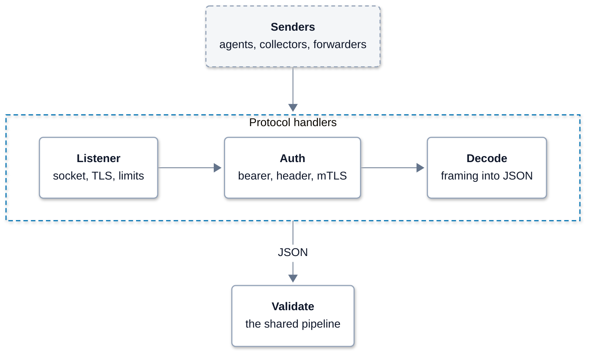

# Protocol handlers

The protocol handlers are the listeners of [dfe-receiver](architecture.md): each one takes a sender's connection and turns what it sent into JSON for the shared pipeline.

| | |
|---|---|
| Repo | [hyperi-io/dfe-receiver](https://github.com/hyperi-io/dfe-receiver) |
| Image and chart | `ghcr.io/hyperi-io/dfe-receiver`, and the thin chart released beside it |
| Config reference | `server`, `grpc`, `otlp`, `lumberjack`, `splunk_hec`, `syslog`, `fluent`, `gelf`, `prometheus_rw` and `flow` in [config-schema.yaml](config-schema.yaml) |
| Endpoints | One port per protocol, listed in the [README](../README.md#what-it-does). `/livez` and `/readyz` on the ingest and metrics ports |
| Metrics | `receiver_requests_total`, `receiver_parse_failures_total`, `receiver_records_dropped_total`, in [metrics.md](metrics.md#requests-and-records) |

Every handler runs the same three steps, whatever its protocol.

*Figure 1. L4 Detail -- Protocol handlers. Senders is outside DFE.* Up: [L3 Components -- Receiver](architecture.md). Down: none.

## How it works

1. Every protocol is switched on in config, except HTTP, which always runs. HTTP serves `/livez` and `/readyz` beside `/ingest`, so exposing ingest exposes both probes. The chart's probes use the same paths on the metrics port.
2. The listener applies its limits before anything else: body size, request timeout, the concurrency and connection caps, the IP filter and the rate limiter. [hardening.md](hardening.md#which-listener-gets-which-control) says which listener gets which.
3. Auth checks the credential on the listeners whose protocol carries one. Syslog, GELF and flow have none. [internals.md](internals.md#authentication) has the modes and how a token rotates.
4. Decode parses the transport framing into JSON and leaves the message body alone. [protocols.md](protocols.md) has what each protocol gives.

## Interfaces

Each handler takes its protocol on its own port and hands JSON bytes to the pipeline. Nothing else crosses: a new protocol adds a handler and a port, never a change to the core path.

`grpc.enabled` defaults to `false`, but a DFE deployment turns it on. dfe-infra's values put the listener on `0.0.0.0:6000`, where it takes Vector's gRPC sink (`PushEvents`). It speaks Vector's protocol, not scalo's Push.

## Scaling and failure

`/readyz` answers 503 until every enabled listener is serving, and again once any of them stops. When a listener can't bind, or stops before shutdown, its handler stops all its listeners. The process logs `Protocol handler failed` and stays up, the ingest port's `/readyz` 503 body names each failed handler, and the error stays in the log. An enabled handler that can't be built fails the same way.

A handler that can't hand a record on, because of memory pressure or a full queue, gives its sender the protocol's retry signal. The table in [internals.md](internals.md#what-a-sender-is-told) has each protocol's answer.

## Key metrics

- `receiver_requests_total` and `receiver_request_duration_seconds`, by `transport`: traffic and answer time per protocol.
- `receiver_parse_failures_total`: bodies a decoder couldn't read.
- `receiver_auth_failures_total`: refused credentials.
- `receiver_records_dropped_total`: records gone with no way to tell the sender, on the protocols with no answer.

## Related

- [protocols.md](protocols.md): what each protocol parses, raw capture and flow
- [hardening.md](hardening.md): fronting the listeners on the internet
- [sidecar-transports.md](sidecar-transports.md): a collector in front for protocols the receiver doesn't take
