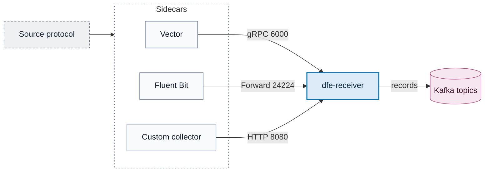

# Sidecar Transport Pattern

dfe-receiver takes the protocols in the README's [protocol table](../README.md#what-it-does).

For protocols not natively supported, use a **sidecar** -- a lightweight
process deployed alongside receiver that collects data from the source
protocol and pushes it to receiver's ingest endpoint.

This diagram shows the three kinds of sidecar and the port each one sends to.



*Figure 1. L4 Detail -- Sidecar transports. The dashed box is external.* Up: [dfe-receiver documentation](README.md).

## Vector, Fluent Bit or a custom collector

The recommended sidecar is [Vector](https://vector.dev/), an observability data pipeline with
many source types. It speaks receiver's native gRPC protocol
through the `vector` sink.

Deploy Vector in the same Kubernetes pod or Docker Compose service.
It collects from the source protocol and pushes to receiver's gRPC
ingest port (`:6000`).

Collect SNMP traps and forward to receiver.

```yaml
# vector.yaml
sources:
  snmp_traps:
    type: socket
    mode: udp
    address: "0.0.0.0:162"
    decoding:
      codec: bytes

transforms:
  snmp_parse:
    type: remap
    inputs: ["snmp_traps"]
    source: |
      .source = "snmp"
      .timestamp = now()
      .source_address = .host

sinks:
  receiver:
    type: vector
    inputs: ["snmp_parse"]
    address: "localhost:6000"
```

Collect logs from Docker containers via the Docker API.

```yaml
# vector.yaml
sources:
  docker:
    type: docker_logs
    include_containers:
      - "app-*"
      - "service-*"

transforms:
  enrich:
    type: remap
    inputs: ["docker"]
    source: |
      .source = "docker"
      .container = .container_name

sinks:
  receiver:
    type: vector
    inputs: ["enrich"]
    address: "dfe-receiver:6000"
```

Collect logs from S3 buckets via SQS notifications.

```yaml
# vector.yaml
sources:
  s3_logs:
    type: aws_s3
    region: "ap-southeast-2"
    sqs:
      queue_url: "https://sqs.ap-southeast-2.amazonaws.com/123456789/log-notifications"

transforms:
  tag:
    type: remap
    inputs: ["s3_logs"]
    source: |
      .source = "aws_s3"

sinks:
  receiver:
    type: vector
    inputs: ["tag"]
    address: "localhost:6000"
```

Collect StatsD metrics on UDP :8125 and forward to receiver.

```toml
# vector.toml
[sources.statsd]
type = "statsd"
mode = "udp"
address = "0.0.0.0:8125"

[transforms.to_json]
type = "remap"
inputs = ["statsd"]
source = '''
.source = "statsd"
.timestamp = now()
'''

[sinks.receiver]
type = "vector"
inputs = ["to_json"]
address = "localhost:6000"
```

Windows Event Log needs a Vector agent on the Windows host, pushing to the receiver over the network.

```toml
# vector.toml (Windows host)
[sources.windows_events]
type = "windows_event_log"
channels = ["Application", "Security", "System"]

[transforms.enrich]
type = "remap"
inputs = ["windows_events"]
source = '''
.source = "windows_event_log"
.host = get_hostname!()
'''

[sinks.receiver]
type = "vector"
inputs = ["enrich"]
address = "dfe-receiver.example.com:6000"
```

Kafka as a source is useful for cross-cluster routing or reprocessing events from an existing
Kafka topic into a different pipeline.

```toml
# vector.toml
[sources.kafka_source]
type = "kafka"
bootstrap_servers = "kafka-broker:9092"
group_id = "dfe-reprocess"
topics = ["raw_events"]
auto_offset_reset = "earliest"

[transforms.tag]
type = "remap"
inputs = ["kafka_source"]
source = '''
.source = "kafka_reprocess"
'''

[sinks.receiver]
type = "vector"
inputs = ["tag"]
address = "localhost:6000"
```

The first alternative is [Fluent Bit](https://fluentbit.io/), a lightweight log processor that
can push to receiver's Fluent Forward endpoint (`:24224`). Forward has no
credential, so the receiver starts its Fluent listener with nothing short of
`fluent.tls.client_auth: required` or `fluent.accept_unauthenticated: true`.

Tailing files and forwarding them:

```ini
# fluent-bit.conf
[INPUT]
    Name   tail
    Path   /var/log/custom-app/*.log
    Tag    custom

[OUTPUT]
    Name   forward
    Match  *
    Host   localhost
    Port   24224
```

Fluent Bit is a good choice when:

- You need a small memory footprint
- You run Fluentd or Fluent Bit
- The source is file-based (tail, systemd) rather than network protocol

The second alternative is a custom HTTP sidecar. For fully custom protocols where neither Vector nor Fluent Bit has a
source, write a small program in any language that speaks your protocol
and POSTs JSON to receiver's HTTP ingest.

In Python:

```python
import httpx

def collect_and_forward(data: dict, receiver_url: str = "http://localhost:8080/ingest"):
    response = httpx.post(receiver_url, json=data)
    response.raise_for_status()
```

In Go:

```go
func forward(data []byte) error {
    resp, err := http.Post("http://localhost:8080/ingest", "application/json", bytes.NewReader(data))
    if err != nil {
        return err
    }
    defer resp.Body.Close()
    if resp.StatusCode != http.StatusAccepted {
        return fmt.Errorf("receiver returned %d", resp.StatusCode)
    }
    return nil
}
```

Choosing between them:

| Criteria | Vector | Fluent Bit | Custom |
|----------|--------|------------|--------|
| Memory footprint | small | smallest | varies |
| Best transport to receiver | gRPC (Vector native) | Fluent Forward | HTTP JSON |
| Language | Rust | C | Any |
| When to use | Most cases | Minimal footprint, file tailing | Novel/proprietary protocols |

## Running a sidecar

Deploy the sidecar in the same pod as receiver:

```yaml
# values.yaml (Helm)
sidecars:
  - name: vector-sidecar
    image: timberio/vector:<version>-alpine  # the tests run VECTOR_IMAGE in tests/common/peers.rs
    args: ["--config", "/etc/vector/vector.yaml"]
    volumeMounts:
      - name: vector-config
        mountPath: /etc/vector
    resources:
      requests:
        cpu: 100m
        memory: 128Mi
      limits:
        cpu: 500m
        memory: 256Mi

extraVolumes:
  - name: vector-config
    configMap:
      name: vector-sidecar-config
```

The sidecar communicates with receiver via `localhost:6000` (gRPC) or
`localhost:8080` (HTTP), with no network hop.

When one sidecar's CPU limit becomes the bottleneck, consider deploying Vector as a separate Deployment (DaemonSet for node-level collection, Deployment for protocol aggregation) rather than a per-pod sidecar.

A starting point for the sidecar container's resources:

```yaml
resources:
  requests:
    cpu: 100m
    memory: 64Mi
  limits:
    cpu: 500m
    memory: 256Mi
```

Increase `cpu` limit if you see throttling under load. Increase `memory` limit if Vector buffers events to disk during backpressure spikes.

When receiver is overloaded it answers `UNAVAILABLE` on gRPC and `503 Service Unavailable` on HTTP. Vector responds by:

1. Pausing event ingestion from the source.
2. Buffering events, in memory by default, or on disk with a disk buffer (`data_dir` and `buffer.max_size`).
3. Retrying delivery with exponential backoff.

This means the sidecar is self-regulating -- set an appropriate disk buffer size to absorb short bursts, and rely on KEDA / HPA to scale receiver for sustained high load.

An init container cannot wait for the receiver: every init container must exit before any container in the pod starts, the receiver included, so one waiting on the receiver holds the pod in `Init` for good. The sidecar needs no wait. Vector retries a sink that rejects connections and buffers meanwhile, and the pod is Ready once every container's readiness probe passes, so the receiver's `/readyz` keeps it out of the Service until the receiver takes traffic.

Where the sidecar must not start sending until the receiver answers, wait in the sidecar's command:

```yaml
# pod spec
containers:
  - name: dfe-receiver
    # ...
    readinessProbe:
      httpGet:
        path: /readyz
        port: 8080

  - name: vector-sidecar
    image: timberio/vector:<version>-alpine  # the tests run VECTOR_IMAGE in tests/common/peers.rs
    command:
      - sh
      - -c
      - |
        until wget -q -O /dev/null http://localhost:8080/readyz; do
          echo "waiting for receiver..."
          sleep 2
        done
        exec vector --config /etc/vector/vector.yaml
    readinessProbe:
      httpGet:
        path: /health
        port: 8686        # Vector's API, with api.enabled: true in its config
      initialDelaySeconds: 5
      periodSeconds: 10
```

In Docker Compose, order the sidecar after the receiver's health check:

```yaml
services:
  dfe-receiver:
    image: ghcr.io/hyperi-io/dfe-receiver:<version>
    healthcheck:
      test: ["CMD", "curl", "-sf", "http://localhost:8080/livez"]
      interval: 5s
      start_period: 10s

  vector-sidecar:
    image: timberio/vector:<version>-alpine  # the tests run VECTOR_IMAGE in tests/common/peers.rs
    depends_on:
      dfe-receiver:
        condition: service_healthy
```

## Troubleshooting

When the connection is refused:

- Receiver may not be ready yet -- Vector retries the sink, or wait in the sidecar's command (see below).
- Wrong port -- gRPC ingest is `:6000`, HTTP is `:8080`. Confirm the sidecar config matches.
- Firewall or Kubernetes NetworkPolicy blocking loopback or pod-to-pod traffic. Within a pod, `localhost` is always reachable -- check NetworkPolicy for cross-pod setups.

When auth fails:

- Bearer token mismatch: the token in the sidecar sink config must exactly match one of the listener's tokens: `grpc.auth.bearer.tokens`, or its `grpc.auth.bearer.secret_source` (`server.auth.*` for HTTP).
- TLS certificate issues: if receiver has TLS enabled, the sidecar must trust receiver's CA. Mount the CA cert and set `tls.ca_file` in the Vector sink.
- Client certificates: set `grpc.auth.mode: mtls`, `grpc.tls.client_auth: required` and the CA in `grpc.tls.ca_file`. Set `tls.crt_file` and `tls.key_file` in the sidecar sink config.

Receiver rejects a gRPC message larger than `grpc.max_message_size` (16 MiB by default) and an HTTP body larger than `server.max_body_size` (10 MiB by default). Large batches from Vector's `batch.max_bytes` can exceed them.

Options:

- Increase receiver's limit, in bytes: `grpc.max_message_size: 67108864` for the `vector` sink, `server.max_body_size: 67108864` for HTTP.
- Reduce Vector's batch size: set `batch.max_bytes = 8388608` (8 MiB) in the sink.

TLS from the sidecar to the receiver:

```toml
# vector.toml -- TLS sink config
[sinks.receiver]
type = "vector"
inputs = ["my_source"]
address = "localhost:6000"

[sinks.receiver.tls]
enabled = true
ca_file = "/etc/ssl/certs/receiver-ca.pem"   # Trust receiver's CA
# mTLS -- only when the receiver requires client certificates:
crt_file = "/etc/ssl/certs/sidecar-client.pem"
key_file = "/etc/ssl/private/sidecar-client.key"
```
