# Setting up an inbound webhook caller

`POST /webhook/{caller}` accepts events pushed by a product -- an alert rule, a
SaaS notification hook -- rather than streamed by an agent. This page is how the
intake handles a request and how to configure a caller, from the auth choice to
proving delivery. Why the intake is separate from `/ingest` is in
[architecture.md](architecture.md#listeners-and-transports), and every field is
in the generated [config-schema.yaml](config-schema.yaml).

Every caller is declared separately with a secret, topic and body
format of its choosing, so two callers never share a credential and a wrong secret is
tried against the caller the URL path names and no other.

## How the intake handles a request

A webhook request passes four admission checks in `src/server/webhook/` before its body is split into records.

```mermaid
---
config:
  theme: base
  look: neo
  fontFamily: Inter, -apple-system, Segoe UI, Roboto, Helvetica, Arial, sans-serif
  flowchart:
    curve: linear
    nodeSpacing: 40
    rankSpacing: 64
    padding: 18
    wrappingWidth: 280
    htmlLabels: true
  elk:
    preset: modelOrder
  themeVariables:
    fontSize: 15px
    lineColor: "#64748B"
    primaryTextColor: "#0F172A"
    clusterBorder: "#0072B2"
    edgeLabelBackground: "#FFFFFF"
  themeCSS: >-
    p{margin:0}
    .node[data-look] rect,.node[data-look] path,.node[data-look] polygon,.node[data-look] .outer-path{filter:drop-shadow(0 1px 2px rgba(15,23,42,.10)) drop-shadow(0 6px 14px rgba(15,23,42,.10))}
    .node rect{rx:10px;ry:10px}
    .cluster rect{rx:16px;ry:16px}
    .node .label div{min-width:150px}
    .node.decision .label div{min-width:0}
    .cluster[data-look] rect{filter:none}
    .nodeLabel{line-height:1.35}
    .nodeLabel b{font-weight:600;font-size:15px;letter-spacing:-0.01em}
    .nodeLabel span{font-size:12.5px;font-weight:400;color:#334155}
    .cluster-label span.nodeLabel{display:inline-block;background:#FFFFFF;color:#0B2A3F;border:1.5px solid #0072B2;border-radius:999px;padding:2px 12px;font-size:11.5px;font-weight:700;letter-spacing:.09em;text-transform:uppercase}
    .flowchart-link{stroke-width:1.75px}
    .labelBkg{background:transparent!important}
    span.edgeLabel{display:inline-block;background:#FFFFFF!important;color:#1E293B;border:1px solid #94A3B8;border-radius:999px;padding:2px 10px;font-size:12px;font-weight:500}
    span.edgeLabel p{background:transparent!important}
    .label-icon{width:20px;height:20px;vertical-align:-4px;margin-right:6px}
    .ingest .label-icon{color:#0E8A7D}
    .xform .label-icon{color:#7B4FB0}
    .load .label-icon{color:#0072B2}
    .bus .label-icon{color:#A8517F}
    .store .label-icon{color:#00785A}
    .ui .label-icon{color:#D9480F}
    .ext .label-icon{color:#64748B}
---
flowchart TB
    accTitle: L4 Detail -- Webhook intake
    accDescr: A webhook request is admitted in four steps, the listener limits, the caller lookup, the caller's auth and the readiness check. Its body is then split into records and filtered. Each record left is validated, stamped and written to the caller's topic.

    subgraph s1["1 Admit"]
        direction LR
        limits("<b>Listener limits</b>") --> lookup("<b>Caller lookup</b>") --> auth("<b>Caller auth</b>") --> ready("<b>Readiness</b>")
    end
    subgraph s2["2 Prepare"]
        direction LR
        split("<b>Split body</b>") --> filter("<b>CEL filter</b>")
    end
    subgraph s3["3 Deliver"]
        direction LR
        validate("<b>Validate</b>") --> stamp("<b>Stamp and clamp</b>") --> topic[("<b>Caller topic</b>")]
    end
    s1 --> s2 --> s3
  classDef ext fill:#F4F6F8,stroke:#94A3B8,stroke-width:1.5px,stroke-dasharray:5 4,color:#0F172A
  classDef ingest fill:#FFFFFF,stroke:#0E8A7D,stroke-width:3px,color:#0F172A
  classDef xform fill:#FFFFFF,stroke:#7B4FB0,stroke-width:3px,color:#0F172A
  classDef load fill:#FFFFFF,stroke:#0072B2,stroke-width:3px,color:#0F172A
  classDef bus fill:#FFFFFF,stroke:#A8517F,stroke-width:3px,color:#0F172A
  classDef store fill:#FFFFFF,stroke:#00785A,stroke-width:3px,color:#0F172A
  classDef ui fill:#FFFFFF,stroke:#D9480F,stroke-width:3px,color:#0F172A
  classDef decision fill:#FFFFFF,stroke:#9A6700,stroke-width:3px,color:#0F172A
  classDef error fill:#FFFFFF,stroke:#C2410C,stroke-width:3px,color:#0F172A
  classDef control fill:#FFFFFF,stroke:#334155,stroke-width:3px,color:#0F172A
  classDef part fill:#FFFFFF,stroke:#94A3B8,stroke-width:1.5px,color:#0F172A
  class limits,lookup,auth,ready,split,filter,validate,stamp part
  class topic bus
  style s1 fill:none,stroke:#0072B2,stroke-width:1.5px,stroke-dasharray:6 4
  style s2 fill:none,stroke:#0072B2,stroke-width:1.5px,stroke-dasharray:6 4
  style s3 fill:none,stroke:#0072B2,stroke-width:1.5px,stroke-dasharray:6 4
```



*Figure 1. L4 Detail -- Webhook intake. Read each stage left to right, then down.* Up: [L3 Components -- Receiver](architecture.md#components).

A caller's records go to the caller's topic on Kafka, never to a gRPC destination, and the rules pick no topic for them. The rules still set `_org_id`, held to `ingest_bindings.credentials.<caller>` because the caller's name is its credential id, or the default org when it has none. With `routing.enrich` on, the default, records are stamped with `_source`, the caller name over any value the sender wrote, and `_timestamp_received`. An oversize body is never a DLQ entry, so unauthenticated bytes do not reach Kafka.

With `webhook.bind_address` unset the routes join the ingest listener after its auth middleware and body limit. They keep their per-caller auth and body limit, and share `server.tls`, `server.ip_filter`, `server.rate_limit` and the concurrency cap. Set, the intake runs on a separate port through the same accept loops and limits, under `webhook.tls`.

## Configuring a caller

Six decisions set up a caller:

| Decision | Key | What hangs on it |
|---|---|---|
| Which listener | `webhook.bind_address` | Unset shares the ingest port. Set, the intake gets a separate port, and that port alone need be reachable from the product's egress |
| How the sender proves itself | `callers[].auth.mode` | `hmac` if the product can sign, `header` if all it can attach is a fixed header |
| Where the secret comes from | `callers[].auth.secret_source` | A `provider:path[:key]` reference, never a literal in the file |
| The replay window | `callers[].auth.tolerance_secs` | Seconds a signature stays valid, `hmac` mode |
| How big a body is allowed | `webhook.max_body_size` | Applies to the intake alone, independently of `server.max_body_size` |
| What reaches the topic | `callers[].body`, `callers[].filter`, `callers[].topic` | One object or an array to fan out, an optional CEL filter, and the topic name used verbatim |

`hmac` is the mode to use whenever the product supports it. The sender computes
HMAC-SHA256 over the string `{timestamp}.{body}` and sends the hex digest in a
signature header, with the same unix-seconds timestamp in a second header. That
proves both that the secret holder sent the request and that the body has not
been altered, and the timestamp bounds replay.

`header` exists because some products can attach nothing but a static header to a
webhook. It proves the sender holds the secret and nothing more: no body
integrity, and no replay protection. Restrict the source addresses with
`server.ip_filter` when using it.

Authentication runs before the readiness check, so an unauthenticated client
learns nothing about the pipeline's state. Failures log at debug and count under
`receiver_auth_failures_total{reason}`, so a credential spray does not write
a warn line per attempt.

`secret_source` is a `provider:path[:key]` reference resolved through the same
reader as bearer tokens and refreshed on `refresh_interval_secs`. A caller with a
secret that cannot be read stops startup rather than serving unauthenticated --
a missing secret is a configuration error.

A sender outside the network needs a resolvable HTTPS endpoint with a publicly
trusted certificate, which an internal certificate authority cannot provide.
Prefer an outbound tunnel over opening an inbound port: the tunnel dials out, so
no public address or inbound rule is needed on the receiver's network.

Some cloud notification services cannot attach custom headers at all and sign
with a certificate of theirs over an envelope that wraps the payload as a string.
Neither shipped auth mode authenticates that envelope, so put a small function
between the service and the intake to unwrap the payload and attach the caller's
header. Do not weaken the intake to accommodate a sender.

## Worked examples

The first example is an asset context source. Its value is not the feed by itself. It is that asset and
identity records join to observability facts, so a noisy signal adds the
context needed to weigh it -- which host, owned by whom, running what, exposed
where. Alert rules from an asset-inventory product, runZero's say, are one such source.

```yaml
webhook:
  enabled: true
  bind_address: "0.0.0.0:8090"     # own port: expose only this to the product
  max_body_size: 1048576
  callers:
    - name: asset_context
      topic: asset_context_land
      auth:
        mode: header               # the product can only attach a static header
        secret_source: "vault:kv/data/dfe/webhooks:asset_context"
        refresh_interval_secs: 300
        header: x-webhook-secret
      body: single
```

Records land on `asset_context_land` stamped with `_source: asset_context` and `_timestamp_received`, as a routed record is. The `_source` stamp is the caller name and wins over any value the sender supplies, which is kept as `_source_original`, so the join key cannot be spoofed by the payload. With `routing.enrich: false` neither is written, and `_org_id` alone is.

The caller's name is its credential id for tenancy as well. Bind it to the orgs
its records may land in, or they land in `routing.default_org_id`:

```yaml
ingest_bindings:
  credentials:
    asset_context:
      orgs: [acme]
```

Pair it with `server.ip_filter` restricted to the product's published egress
range, because `header` mode has no body integrity.

The second example is an observability feed. An alerting platform that can attach an `Authorization` header fits `header`
mode directly -- the header accepts a bare secret or a `Bearer <secret>` form.
A platform that signs its payloads should use `hmac` instead.

```yaml
webhook:
  enabled: true
  callers:                          # bind_address unset: shares the ingest port
    - name: alerting
      topic: alerting_land
      auth:
        mode: hmac
        secret_source: "vault:kv/data/dfe/webhooks:alerting"
        refresh_interval_secs: 300
        header: x-signature
        timestamp_header: x-timestamp
        tolerance_secs: 300
      body: array                   # the platform batches alerts per POST
      filter: 'severity == "critical" || severity == "high"'
```

`body: array` checks, filters and stamps every element before delivering any of
them, so one element that is not an object rejects the whole request with
nothing on the topic. A sender that retries therefore duplicates nothing.

The CEL filter is compiled at load, so a malformed expression is a startup
error rather than a per-request surprise. A record the filter drops still
answers 202: the sender did nothing wrong and must not retry.

`contains` matches a substring of a string and nothing else. Test list membership with `"pii" in tags` and a map key with `"region" in meta`. `tags.contains("pii")` on a list is an evaluation error. A filter that errors on a record, or answers with something other than a boolean or a number, rejects the whole request with a 500 `filter_error`, and nothing is delivered. A filter that answers false drops a record, and nothing else does.

On the shared listener the caller's secret is the one credential needed --
`server.auth` does not apply to the webhook routes -- and `server.tls`,
`server.ip_filter` and `server.rate_limit` all still do.

## What the sender will see

| Status | Meaning | `error` field |
|---|---|---|
| 202 | Every record accepted, including a record the filter dropped | -- |
| 400 | The body format is wrong for the declared `body`, or validation refused a record for good | `body_not_an_array`, `record_not_an_object`, or the validation reason |
| 401 | Authentication failed | `missing_signature`, `invalid_signature`, `missing_timestamp`, `invalid_timestamp`, `stale_signature`, `missing_auth_header`, `invalid_header_value` |
| 404 | No caller of that name is declared | `unknown_caller` |
| 413 | Over `webhook.max_body_size`, counted and never sent to the DLQ | -- |
| 429 | `server.rate_limit` exhausted, with `retry-after` | -- |
| 500 | The filter could not evaluate a record, and nothing was delivered | `filter_error` |
| 503 | A record could not be taken -- memory pressure, a full hold, the bus down -- with `retry-after` | -- |

A 401 is the sender's problem and a 503 is ours, so treat them differently when
configuring the product's retry behaviour: 503 and 429 should be retried, and a
401 should page whoever rotated the secret. A 503 can follow records of the
same request that were taken, so a retry delivers those twice -- never zero
times.

## Proving it works

Send a signed request by hand. The signature is HMAC-SHA256 over
`{timestamp}.{body}`, so the timestamp must be the one in the header:

```bash
TS=$(date +%s)
BODY='{"severity":"high","host":"example"}'
SIG=$(printf '%s.%s' "$TS" "$BODY" \
  | openssl dgst -sha256 -hmac "$WEBHOOK_SECRET" -hex \
  | sed 's/^.*= //')
curl -sS -o /dev/null -w '%{http_code}\n' \
  -X POST "https://receiver.example/webhook/alerting" \
  -H 'content-type: application/json' \
  -H "x-timestamp: $TS" \
  -H "x-signature: sha256=$SIG" \
  --data "$BODY"
```

Then confirm the record arrived rather than assuming the 202 means delivery:
read the caller's topic, and check `receiver_requests_success_total` moved and
`receiver_auth_failures_total` did not. The integration suite covers both
halves -- the intake's behaviour in `tests/integration/webhook.rs`, and the path
through to a running broker in `tests/integration/protocol_kafka_roundtrip.rs`.
